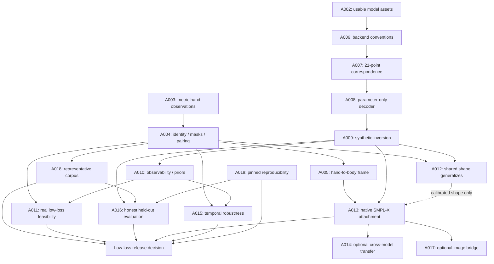

# V1.2 hand roundtrip: assumption chains

**Updated:** 2026-10-06 from [V1.2 findings](V1_2_Findings.md).

**Date checked:** 2026-10-05. **Plan:** [V1.2 hand roundtrip](V1_2_Hand_Roundtrip_Plan.md).

**Outcome:** Reconstruct MediaPipe hand observations through genuine MANO and SMPL-X parameters
with measured low landmark loss, while keeping coordinate, anatomical, and attachment claims explicit.

Confidence uses `confirmed`, `likely`, `unknown`, or `risky`. Status uses `verified`, `open`, or
`broken`. “Confirmed” is scoped to the stated evidence: API documentation or file presence does
not prove successful runtime fitting. Blast radius means which outputs or claims depend on it.

## 1. Evidence registry

| ID | Evidence and scope |
| --- | --- |
| E01 | [V1 scope](V1_Problem_Scope.md), [findings](V1_Findings.md): final accepted arm-only results and corrections. Historical measurements, not rerun in this planning pass. |
| E02 | [Current extractor](../scripts/extract_world_landmarks.py), [format definitions](../src/kinetic_augment/utils/data_formats.py): current world-body versus legacy image-hand contracts. |
| E03 | [Current converter](../src/kinetic_augment/body_model/converter.py), [skeleton](../src/kinetic_augment/body_model/skeleton.py), [wrapper](../src/kinetic_augment/body_model/smplx_wrapper.py), [mapping](../src/kinetic_augment/body_model/joint_mapping.py): available code and configuration mismatches. |
| E04 | [Google Hand Landmarker guide](https://developers.google.com/edge/mediapipe/solutions/vision/hand_landmarker/python): hand-world units/origin and image-coordinate semantics; checked 2026-10-05. |
| E05 | [Legacy Hands documentation](https://github.com/google-ai-edge/mediapipe/blob/master/docs/solutions/hands.md): handedness/mirroring convention; selected API behavior still needs a local test. |
| E06 | [SMPL-X model source](https://github.com/vchoutas/smplx/blob/main/smplx/body_models.py), [joint names](https://github.com/vchoutas/smplx/blob/main/smplx/joint_names.py), [tip vertices](https://github.com/vchoutas/smplx/blob/main/smplx/vertex_ids.py): backend mechanics; upstream main is not a pinned installed version. |
| E07 | [Correspondences](https://github.com/vchoutas/smplx#mano-and-flame-correspondences), [transfer guidance](https://github.com/vchoutas/smplx/blob/main/transfer_model/README.md): target geometry needs verification; beta copying is unsupported. |
| E08 | [MANO asset index](../models/mano/index.md), [conversion utility](../scripts/convert_mano.py), [official MANO version history](https://mano.is.tue.mpg.de/): asset provenance matters; MANO v1.1 changed shape-space scaling. |
| E09 | [Frozen E11](../scripts/review_checks/direction-and-blocker/e11_out.txt), [review assessment](V1_Review_Assessment.md): historical wrist detachment and evaluation pitfalls. |
| E10 | [Project dependencies](../pyproject.toml), [agent guide](../AGENTS.md): optional model dependencies, MediaPipe pin, Python support, and asset conventions. |
| E11 | [Plan's local snapshot](V1_2_Hand_Roundtrip_Plan.md#2-starting-point-what-carries-over-from-v1): read-only array and package probes found 410 image frames, body-only world arrays, asymmetric hand coverage, locally present weights, and conflicting SMPL-X version labels. |

The plan records the inspected HEAD and dirty-tree limitation. Before implementation, P0 must
capture exact hashes of relevant source, data, assets, installed packages, and any upstream files
used to build the adapter.

## 2. Assumption ledger

| ID | Falsifiable claim / type | Depends on | Evidence | Confidence / status | Cheapest decisive verification | Failure signal → consequence / response |
| --- | --- | --- | --- | --- | --- | --- |
| **A001** | The intended second model is MANO, and landmark fidelity is the priority. Product. | none | User wording, repository MANO assets; explicit priority reply. | likely / open for name; priority confirmed | Confirm naming if user corrects it; default to MANO. | Another model was intended → replace that backend brief; retain data and metric design. |
| **A002** | Locally available MANO and SMPL-X assets can run compatible differentiable forwards. Runtime/capability. | A001 | E08, E10, E11; files/code exist, actual hand forwards unverified here. **2026-10-06:** `test_points_equal_the_full_model_forward` and `test_gradients_are_exact` (`tests/test_hand_model.py`) pass on both backends and sides on CPU; asset SHA-256 and package versions in `data/test_output/hand_round_trip.json` ([findings §6](V1_2_Findings.md)). | confirmed / verified | Instantiate both sides on CPU, finite forward and gradients, record versions/hashes/units. | Missing/incompatible assets or gradients → P1 and all numeric hand claims stop; data work continues. |
| **A003** | The selected installed MediaPipe API exposes usable 21-point hand-world observations. Capability/data. | none | E04; existing extractor E02 does not store them. **2026-10-06:** `scripts/extract_hand_landmarks.py` (legacy `Hands`, MediaPipe 0.10.21) gives 547 detections in 410 frames, each assigned hand with 21 finite world points in metres (`data/test_output/*_hands.npz`); `test_hands_are_metric_sided_and_missing_as_nan` passes ([findings §5](V1_2_Findings.md)). | confirmed / verified for legacy `Hands` | Extract a labeled one-hand and two-hand clip through the pinned version; save schema and valid counts. | No world output or unusable detections → revise extraction or define a separate image-only study; no mm claim from image z. |
| **A004** | Side identity, masks, frame pairing, and extraction state are reliable. Data. | A003 | E05; E01 documents a prior clip-order contamination bug. **2026-10-06:** `test_a_clip_does_not_depend_on_the_clip_before_it` (mutation-checked) and `TestAssignSides` pass; on the pilot every assigned hand's wrist lies within 8.1% of the image height of its pose wrist (median 2.1%), and the label, read as unmirrored, agrees on 528/535 ([findings §5](V1_2_Findings.md)). No labelled sides or crossing-hand fixture; fit quality cannot check sides (findings §4.6). | likely / open: clip independence and masks verified; sides consistent on the pilot but not ground-truthed | Labeled mirrored/unmirrored clips, order reversal, crossing and missing-hand fixtures. | Swaps, stale state, timestamp mismatch → reject affected records; all fit/evaluation results from them are invalid. |
| **A005** | A justified transform relates hand-world orientation to body-world orientation. Integration. | A003, A004 | E04 establishes local origins, not a verified shared frame. E09 shows attachment risk. **2026-10-06:** probe: hand-world axes equal pose-world axes ([probes](V1_2_Feasibility_Probes.md)); no attachment attempted (P4; [findings §5](V1_2_Findings.md)). | likely / open: axes agree (probe); attachment untested | Controlled rotations and paired image/body checks, explicit frame transform and handedness tests. | Palm appears rotated/flipped when attached → local reconstruction can stand; global attachment/reprojection claim cannot. |
| **A006** | Model order, units, side, pose mean, PCA setting, root convention, and beta dimensions are consistent. Integration. | A002 | E03 exposes mean/beta configuration differences; E06 describes mechanics. **2026-10-06:** `test_points_equal_the_full_model_forward`, `test_zero_pose_is_the_flat_template_hand`, `test_landmarks_follow_hand_anatomy`, `test_tips_extend_their_distal_bone`, `test_left_hand_is_the_mirror_of_the_right` and `test_one_joint_moves_only_its_own_finger` (`tests/test_hand_model.py`) pass on both backends; no renders ([findings §6](V1_2_Findings.md)). | confirmed / verified by numerical checks; no renders | Zero/one-joint pose parity, dimensions, scale, direct-backend replay, left/right renders. | Curled zero hand, wrong finger, 1,000× scale, offsets → fix conventions before optimizer/shape tuning. |
| **A007** | A fixed 21-point adapter is sufficiently close to MediaPipe's landmark semantics. Data/integration. | A002, A006 | E03, E06 give topology, but surface-versus-joint agreement is unmeasured. **2026-10-06:** `test_landmarks_follow_hand_anatomy` and `test_tips_extend_their_distal_bone` pass; on the pilot the thumb is the worst finger once each frame has its own shape; per-landmark residuals and alternative adapters not examined ([findings §4.3](V1_2_Findings.md)). | risky / open | Neutral/posed visual landmarks, per-point residual structure, compare fixed adapters on held-out data. | Persistent thumb/base/tip bias across fits → revise and version correspondence; extra pose freedom is not proof of a solution. |
| **A008** | The decoder reconstructs from real parameters without source-landmark leakage. Integration. | A006, A007 | E01 explains why the legacy near-zero result was invalid; E03 provides a genuine body precedent. **2026-10-06:** `test_a_fresh_process_rebuilds_the_hands_from_saved_parameters` (`tests/test_hand_converter.py`) passes: a new process given only the saved parameters and the model rebuilds the hands to within 1e-12 m ([findings §6](V1_2_Findings.md)). | confirmed / verified | Serialize/reload in a clean process without observations; sample joint and tip outputs through actual forward. | Accuracy vanishes without input/cache → invalidate the roundtrip result and repair the API. |
| **A009** | The solver reaches low point error for well-conditioned, known-feasible synthetic observations. Capability. | A006, A007, A008 | No genuine hand fitter tested in this pass. **2026-10-06:** `test_recovers_hands_the_model_can_represent` (both backends and sides; mean 0.007–0.016 mm, p95 at most 0.051 mm) and `test_a_fitted_shape_reproduces_a_plausible_hand` (mean 0.069 / 0.108 mm) pass against the 0.5 mm / 1 mm gate, as does `test_gradients_are_exact`. Single start; no multi-start ([findings §4.1](V1_2_Findings.md)). | confirmed / verified on synthetic hands (single start) | Both-side synthetic corpus, independent adapter check, multiple starts, gradient sanity. | Synthetic targets fail → convention or optimization defect; real-data “model floor” conclusions are premature. |
| **A010** | Observable landmarks constrain enough motion for stable reconstruction; unresolved rotations can use an explicit prior. Data. | A007, A009 | E01 establishes body twist ambiguity; hand observability remains unmeasured. **2026-10-06:** Jacobian of the 20 wrist-relative landmarks: 10 of the 48 rotation directions are numerically null on every track and backend, and more are weak at larger thresholds, spread over the finger joints (`observability` in `data/test_output/hand_round_trip.json`; [findings §4.5](V1_2_Findings.md)). A pose prior settles them. Multi-start and occlusion not run. | risky / open: rank measured, so the rotations are known not to be unique; stability across starts and under occlusion untested | Jacobian/rank and multi-start analysis across poses; remove tips/occlude joints and compare. | Same landmarks, unstable mesh/rotations → strengthen declared priors/uncertainty; do not claim unique anatomical recovery. |
| **A011** | Real MediaPipe hands fit the plausible MANO and SMPL-X families within the proposed 5 mm mean target. Data/product. | A003, A004, A007, A009, A010 | Missing; V1 body results cannot establish hand feasibility. **2026-10-06:** pilot error ladder (`data/test_output/hand_round_trip.json`, `pooled`): held-out mean 7.39–10.92 mm (MANO) and 7.48–11.18 mm (SMPL-X), p95 20.93–35.16 mm; only the per-frame-shape diagnostic, not an achievable result, gets under 5 mm ([findings §1–2](V1_2_Findings.md)). No sealed test set; no multi-start reference. | broken on the pilot: one plausible shape per track misses the 5 mm mean and the 15 mm p95 on both backends | Pilot error ladder with fixed masks and priors, then frozen held-out evaluation. | Best-found plausible fit still misses gate → report bounded negative result, locate bias/non-rigidity, revise scope explicitly. |
| **A012** | A sequence-shared regularized hand shape improves held-out fit without merely chasing detector drift. Data. | A004, A007, A009 | E01 provides a caution about shape ambiguity, not evidence for hands. **2026-10-06:** all 90 fitted shape norms sit at 99.57–99.97% of the plausibility bound. Held out over time halves, the shape is worse than the neutral one on 7/9 (MANO) and 6/9 (SMPL-X) tracks, tracking MediaPipe's hand-size drift (r = 0.89 / 0.73), not overfitting; over interleaved frames it is within 0.04 mm of in-sample (`data/test_output/hand_round_trip.json`; [findings §4.2, §4.4](V1_2_Findings.md)). | risky / open: prior saturated; any held-out gain depends on the split | Neutral/calibrated ablation on disjoint blocks; inspect prior saturation, stability, left/right behavior. | Extreme betas or only in-sample gains → keep neutral/strongly regularized shape; widen uncertainty, not capacity automatically. |
| **A013** | Native SMPL-X can fit hands while preserving acceptable V1 arm behavior. Integration. | A005, A006, A009; A012 only for calibrated-shape extension | E03 has shared body shape; independent MANO betas do not exist in SMPL-X. | risky / open | Frozen-body direct fit first; wrist-parent FK test; constrained shared-beta tradeoff second. | Good hands require poor arms or detached transforms → report separate backend limits; do not label a stitched mesh standard SMPL-X. |
| **A014** | MANO-to-SMPL-X transfer gives useful initialization at tolerable extra error. Integration. | A006, A007, A009, A013 | E07 offers correspondences, not parameter equivalence. | unknown / open | Both-direction cross-model roundtrips and direct-fit comparison across poses/shapes. | Transfer adds bias or diverges → use direct target fitting; both primary routes can still ship. |
| **A015** | Temporal regularization reduces instability without erasing real finger motion or hand identity. Data/runtime. | A004, A009, A010 | No hand-sequence evidence yet. | unknown / open | Static and fast-motion clips, missing intervals, reacquisition, error/lag/stability ablation. | Smoother but delayed/misarticulated signs → lower/adapt regularization; retain accurate framewise baseline. |
| **A016** | Release evaluation uses valid masks, splits, aggregation, and reproducible representative data. Data/product. | A004, A008, A009, A018, A019 | User prioritizes low landmark loss; E01/E09 show previous metric failures. | unknown / open | Fixed test IDs, known-bad mapping controls, all-frame coverage, per-side/tip/tail reports, calibration disjointness and pinned replay. | Good pooled score with rejected hard frames or leaked targets → reject the headline and rerun clean evaluation. A011 failing its numeric target is a valid negative result, not an invalid evaluation. |
| **A017** | A validated camera can map model output back to the desired image representation. Integration. | A003, A004, A005, A013 | E04 distinguishes image z; E09 camera experiments are historical and imperfect. | unknown / open | Paired 2D reprojection, identity and known 3D perturbation tests, camera parameter/gauge audit. | Local fit good but image gap/high reprojection error → keep image integration gated; do not alter the 3D fit to conceal camera errors. |
| **A018** | Available clips cover enough hands/poses to assess the intended use. Data/product. | A003, A004 | E11: five-clip pilot; 01991 has no detected left hand in its cache. Coverage is known, representativeness is not. **2026-10-06:** 5 clips of 4 people ([V1 scope, Finding 10](V1_Problem_Scope.md)), 9 hand tracks, 535 frame-sides, no left hand in 01991 ([findings §5](V1_2_Findings.md)): below the plan §8 minimum of 20 clips and 5 people. | broken for the current five clips: results are bounded to the pilot | Inventory pose/side/occlusion coverage and signer labels; create independent held-out corpus. | One side/person/pose dominates → bound result to pilot; collect missing cases before general claims. |
| **A019** | A pinned CPU-capable environment makes evidence reproducible without bundling licensed weights. Runtime/maintenance. | A002, A003 | E10/E11: installed versions inventoried; conflicting asset labels and manifest still unresolved. **2026-10-06:** package versions and the SHA-256 of the model assets and hand clips are in `data/test_output/hand_round_trip.json`; extraction and measurement reproduce bit for bit on this machine; SMPL-X is v1.1 by content although `models/smplx/version.txt` says 1.0 ([probes](V1_2_Feasibility_Probes.md); [findings §9](V1_2_Findings.md)). No clean-environment replay. | likely / open: hashes recorded and same-machine replay exact; clean-environment replay not done | Clean-env instructions, asset checksums, CPU smoke, seeded solver, repeat reports within tolerance. | Version/asset changes move landmarks or all tests skip → invalidate version-crossed comparisons until re-baselined. |

## 3. Claims already rejected as starting assumptions

| Rejected claim | Evidence / correction | What breaks if it reappears |
| --- | --- | --- |
| Existing `*_world.npz` files already provide metric hands. | E02: current extractor is pose-only. | Fitting normalized image-hand arrays as metres invalidates mm scores. |
| A 45-value array is automatically a valid hand pose. | E01/E03: old converters stored bone vectors, not rotations. | A numerical identity is mislabeled a model conversion. |
| Zero pose means the same thing across current wrappers. | E03: `flat_hand_mean` differs. | Adapter and optimization comparisons start from different hands. |
| Upstream MANO always returns 21 joints. | E06: tip appending can be disabled. | Missing fingertips or silently wrong index mapping. |
| MANO and SMPL-X betas can be copied directly. | E07: different shape models; no standalone hand beta slot in SMPL-X. | Altered whole body, inconsistent mesh and hand lengths. |
| Low temporal jitter proves low reconstruction error. | E01: V1 explicitly retracted this inference. | A stable systematic landmark bias passes incorrectly. |
| A low 21-point loss proves unique anatomy/rotations. | Inverse problem can have multiple solutions; A010 must measure the hand case. | Anatomical/augmentation claims exceed observed evidence. |

## 4. Dependency map

An arrow means the downstream item requires the upstream item; optional branches are labeled.

The ledger is authoritative for full dependency lists; the diagram highlights the principal
chains. A001 defines scope; A019 supports all replayed evidence. A014 failure does not invalidate
direct fitting, and A017 failure does not invalidate local 3D reconstruction.

## 5. Verification order: cheapest decisive checks first

1. **Metadata and schema:** inspect current arrays without re-extracting, check the installed
   MediaPipe API/version, inventory asset hashes and side variants. Verify A002/A003/A019 scope.
2. **One-clip extraction:** labeled hands, mirrored/unmirrored input, state reset and reordered
   clips, saved timestamps/masks. Resolve A003/A004 before collecting a large corpus.
3. **One model forward per side/backend:** neutral and single-joint perturbation, tip extraction,
   basis/units and serialization replay. Resolve A006–A008 before any hyperparameter search.
4. **Small synthetic inversion suite:** open/flexed/thumb poses, rigid equivariance, independent
   mapping oracle and gradient checks. Probe A009/A010 before interpreting real-data residuals.
5. **Pilot real fits and shared shape:** fixed adapter, robust baseline, development-validation
   blocks disjoint from shape calibration, best-found references and pose/shape ablations. Assess
   provisional A011/A012 feasibility and freeze numeric targets before opening final test data.
6. **Attachment:** parent-relative wrist orientation, shared-frame evidence, frozen-body
   non-regression, then cross-model transfer. Resolve A005/A013; assess optional A014.
7. **Expanded corpus and temporal holdout:** split by signer/clip, tune temporal settings only on
   validation, then freeze settings/adapters/masks before final test access. Independently assess
   A011/A015/A016/A018 on the untouched final set with no post-hoc exclusions or threshold changes.
8. **Optional camera bridge:** only after 3D correctness; assess A017 separately.

## 6. Failure traces and decisions

| Observed symptom | Trace backward | Decisive next check | Decision if confirmed |
| --- | --- | --- | --- |
| Every hand is curled at zero input | A009 → A006 | Inspect flat mean/PCA; compare direct forwards. | Repair convention, invalidate prior fits. |
| Only thumb/tips have a stable large residual | A011 → A007 → A006 | Render named points; verify tip topology and thumb mapping before changing loss weights. | Fix adapter or report correspondence mismatch. |
| Synthetic fit fails but real error looks small | A016 → A008/A009 → A006/A007 | Remove source arrays from decoder; test a deliberately permuted map. | Reject claimed accuracy; fix leak/evaluator or solver. |
| MANO is accurate, SMPL-X hands are wrong | A013/A014 → A006/A007/A012 | Compare direct SMPL-X fit, shared shape, wrist frame, and means separately. | Prefer direct fitting; disclose SMPL-X model limitations. |
| Local hands fit, attached hands float or face backward | A013 → A005/A006/A004 | Check side, basis, parent FK, and body-wrist residual independently. | Keep local result; attachment remains unvalidated. |
| Shape norms grow as residual shrinks | A011 → A012/A007 | Held-out shape ablation and prior saturation; inspect mesh. | Keep regularized fit, report representation mismatch. |
| Error improves only after deleting difficult frames | A016 → A004/A018 | Recompute full eligibility/coverage and fixed-mask metrics. | Withdraw headline; retry with honest counts. |
| Smooth output loses quick finger gestures | A015 → A010/A004 | Time-aligned position/lag comparison with framewise fits. | Reduce temporal prior; do not trade motion away invisibly. |
| Good local scores, bad image reconstruction | A017 → A005/A004 | Camera-only residual and known 3D transform tests. | Revise projection; preserve separately valid local fit. |

## 7. Gate decision and highest risks

**Decision: go-with-risks for P0–P2 only.** Required code/API concepts exist, and the cheapest
checks can establish a truthful baseline. No evidence yet supports declaring the proposed real
hand error thresholds achievable.

The most likely project-limiting assumptions are **A007** (keypoint semantics), **A011** (model
capacity versus detector observations), **A005** (frame alignment), and **A013** (shared SMPL-X
shape/body constraints). A failure in these can change the attainable result even with a correct
optimizer. A006/A008 failures instead invalidate the experiment itself and must be fixed first.

When implementation begins, update this ledger from actual check output and attach report paths.
Do not mark an assumption verified because a plan describes how to verify it.
