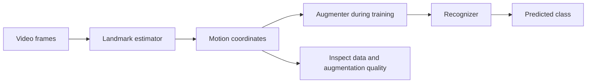
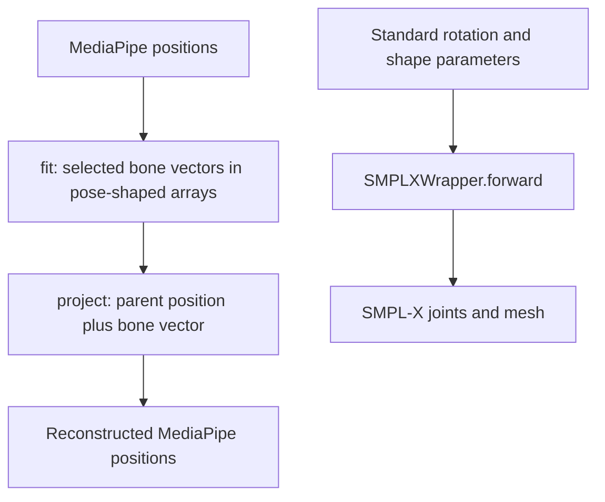

# 1. What problem is this project trying to solve?

[Guide index](index.md) · Next: [the code map](02-code-map.md)

## The research question in ordinary language

A motion recognizer learns from examples of people moving. If training data contains only a few people, camera positions, or signing speeds, the model may learn incidental details instead of the intended class. **Data augmentation** creates transformed training examples so a model has more opportunities to learn which variations should leave the answer unchanged.

For landmark coordinates `X` and label `y`, augmentation creates `X' = A(X)`. The dataset usually reuses `y`. That reuse assumes the transformation preserves the class. It is an assumption to test, not a consequence of writing a transformation function.

**Code present:** this project contains transforms, a configurable pipeline, constraints, dataset wrappers, metrics, and recurrent classifiers. **Historical claim:** the [README](../../README.md) calls it production-ready and says semantic integrity is preserved. This guide does not establish either claim. **Unknown intent:** source does not specify which scientific hypothesis or experiment a previous researcher intended. Its visible scope supports investigating geometry-aware motion augmentation; the mentor should confirm the intended contribution.

## Two intended applications

| Application | Input and target | Potential benefit | What needs protection |
| --- | --- | --- | --- |
| Sign Language Recognition (**SLR**) | A signing clip mapped to a sign class. | Generalization across signers, viewpoints, and timing. | Hand configurations, locations, motion, and relevant facial information may matter; invariance depends on the sign and dataset. |
| Human Activity Recognition (**HAR**) | A motion clip mapped to an activity such as running. | Generalization across subjects and motion styles. | Task-defining patterns and environmental contacts may matter; speed can itself define a class boundary. |

These intentions appear in [the SLR profile](../../configs/slr_profile.yaml) and [the running profile](../../configs/har_running_profile.yaml). Their priority comments are design proposals, not measurements of linguistic or activity invariance. A transformation appropriate for running should not automatically be applied to a sign. Even within SLR, a class-specific judgment may be necessary.

## Why arbitrary coordinate noise is risky

A skeleton is a graph: nodes are landmark locations, and edges connect related body parts. A **kinematic chain** is an ordered sequence such as shoulder → elbow → wrist. In a real arm, bones connect the joints; changing a shoulder's orientation changes where downstream joints can be.

Imagine a desk lamp with hinged segments. Move one hinge and its attached segment moves with it. Independently shifting every point on the lamp would stretch its metal, separate its joints, or send its shade through its base. Independent skeleton noise can create similar errors.

For example, let shoulder `s = (0, 0, 0)` and elbow `e = (1, 0, 0)` in arbitrary units. Their separation is 1. If noise moves only the elbow to `(1.4, 0, 0)`, the apparent upper arm length becomes 1.4. If the displacement differs sharply between frames, it also creates an abrupt velocity. These illustrate failure modes, not measured behavior of a particular dataset.

A whole-body rigid rotation preserves pairwise distances in a common Euclidean coordinate system. Independent per-joint perturbation generally does not. Uniform scaling preserves proportions but changes absolute distances. Even a geometrically consistent transform can change a label: plausible motion and correct meaning are separate requirements.

## Three kinds of variation

| Kind | Intuition | Local example | Qualification |
| --- | --- | --- | --- |
| **Extrinsic** | Change how the entire motion is situated or observed. | `GlobalRotation`, `GlobalScaling`, `PoseFlipping` in [extrinsic.py](../../src/kinetic_augment/augmentations/extrinsic.py). | Coordinate rotation is a simplified viewpoint model; it does not render perspective or occlusion. Reflection needs semantic review. |
| **Intrinsic** | Change articulated configuration or body shape. | `JointAnglePerturbation`, `HandPosePerturbation`, `LimbLengthScaling` in [intrinsic.py](../../src/kinetic_augment/augmentations/intrinsic.py). | Parameter names and sizes do not establish valid rotation or shape contents. |
| **Temporal** | Change when motion is sampled or how quickly it unfolds. | `TimeWarping`, `SpeedVariation`, `FrameDropping` in [temporal.py](../../src/kinetic_augment/augmentations/temporal.py). | Smooth resampling can alter timing cues; interpolation depends on representation. |

Think of filming a dance: move the camera for extrinsic variation, change the dancer's arm pose for intrinsic variation, and retime the recording for temporal variation. Here transforms operate on arrays instead of generating new video pixels.

## Estimator, augmenter, and recognizer are different jobs

A **landmark estimator** predicts locations from images. An **augmenter** modifies an existing motion representation. A **recognizer** predicts a task label from motion. Training a recognizer does not by itself validate the estimator's coordinates or the augmenter's label assumptions.

Text fallback: video → estimator → coordinates → training augmentation → recognizer → class. Data and augmentation also need inspection. Evaluation clips should ordinarily bypass random training augmentation; chapter 4 explains the dataset implementation.

**Code present:** `MediaPipeExtractor` in [render_landmarks.py](../../scripts/render_landmarks.py), lines 35–68, calls MediaPipe Holistic on video frames. `Pipeline.process` in [pipeline.py](../../src/kinetic_augment/pipeline/pipeline.py), lines 98–129, calls an augmentation chain. `LSTMClassifier` and `GRUClassifier` in [lstm_classifier.py](../../src/kinetic_augment/evaluation/models/lstm_classifier.py) are downstream recognizers, not SMPL-X estimators.

MediaPipe's legacy Holistic combines body, face, and hand estimators into 543 landmarks. It is the relevant external background for this checkout's format; newer APIs should not silently replace its coordinate convention. [Official legacy Holistic documentation](https://github.com/google-ai-edge/mediapipe/blob/master/docs/solutions/holistic.md).

## Positions and body parameters describe different things

**Landmark positions** say where selected points are. A clip is a NumPy array `(T, J, 3)`: time frames, landmarks, and coordinate values. Coordinates are estimates, not a full body surface. Some extraction code represents missing detections with zeros.

**Body parameters** describe a generative body model. Standard SMPL-X combines an articulated body, hands, and face. Pose controls rotations; shape coefficients describe body geometry variation; expression coefficients control facial deformation. Applying the model produces joints and a mesh, a surface of vertices and faces. SMPL-X is a representation; **SMPLify-X** is a method for fitting it to observations. [SMPL-X project and paper](https://smpl-x.is.tue.mpg.de/).

**Forward kinematics** computes positions from chain rotations and link geometry. **Inverse kinematics** attempts to infer configurations explaining observed positions. Body-model fitting may additionally involve shape, camera parameters, uncertainty, and regularization. It is not equivalent to reshaping an array. [Official SMPL-X implementation](https://github.com/vchoutas/smplx).

An **axis-angle rotation vector** points along the rotation axis; its length gives an angle in radians. A **bone vector** is `child_position - parent_position`: it points along a segment and its length is the segment's length. Both contain three numbers, with different meanings and units.

### The consequential representation warning

**Code present:** [`MediaPipeToSMPLX.fit`](../../src/kinetic_augment/body_model/mp_to_smplx.py), lines 92–143, stores bone vectors inside arrays named `body_pose` and hand pose. Its module explicitly says this is **not standard SMPL-X axis-angle** (lines 22–25). [`SMPLXToMediaPipe.project`](../../src/kinetic_augment/body_model/smplx_to_mp.py), lines 70–173, reconstructs selected positions by vector addition along chains; it accepts a wrapper but never calls it.

In contrast, [`SMPLXWrapper.forward`](../../src/kinetic_augment/body_model/smplx_wrapper.py), lines 143–221, calls the actual SMPL-X model with rotation parameters. Intrinsic classes and angle constraints are written around rotation-style slots. **Inference:** passing the encoder's bone vectors through rotation operations or into the true model mixes meanings even if shapes pass validation. A reconstruction image from the bespoke vector path cannot establish accurate SMPL-X fitting. Consult [project status](05-project-status.md) (planned) for verification scope and compatibility; the encoder's name is not evidence of an inverse-kinematics solver.

Text fallback: two routes exist. The local `fit`/`project` pair encodes and reconstructs bone vectors. The actual model wrapper consumes standard model parameters and generates geometry. Similar dictionary keys do not make them interchangeable.

## Constraints help with specific checks

A **constraint** restricts allowable values or relationships. Here joint limits restrict pose values, velocity limits restrict frame-to-frame angular changes, and collision code aims to detect or correct intersecting body parts. Clamping a value does not prove biomechanics or class preservation.

**Code present:** the modern pipeline applies its chain first, then its constraint engine. In landmark mode, `_enforce_constraints` returns the augmented array unchanged—even with a wrapper—because conversion and enforcement are a TODO ([pipeline.py](../../src/kinetic_augment/pipeline/pipeline.py), lines 131–158). In SMPL-X mode, a dictionary is handled as a pose/batch; a list of frame dictionaries uses sequence enforcement. Velocity enforcement needs a previous frame, so these routes differ.

A YAML comment such as `semantic_check: preserve_handshape_class`, or a preset named `conservative`, does not establish an automatic linguistic validator. Constraints also do not establish environmental contact, physical dynamics, or recognition gains merely by being present. Read [project status](05-project-status.md) before interpreting README guarantees.

## Check your understanding

Try explaining why a rigid rotation can preserve geometry without proving class preservation; why `(T, 543, 3)` and `(B, 63)` carry different structure; and why a bone vector cannot be treated as an angle. Then follow an explicit configuration through [the code map](02-code-map.md). Chapter 3 develops the mathematics further.
