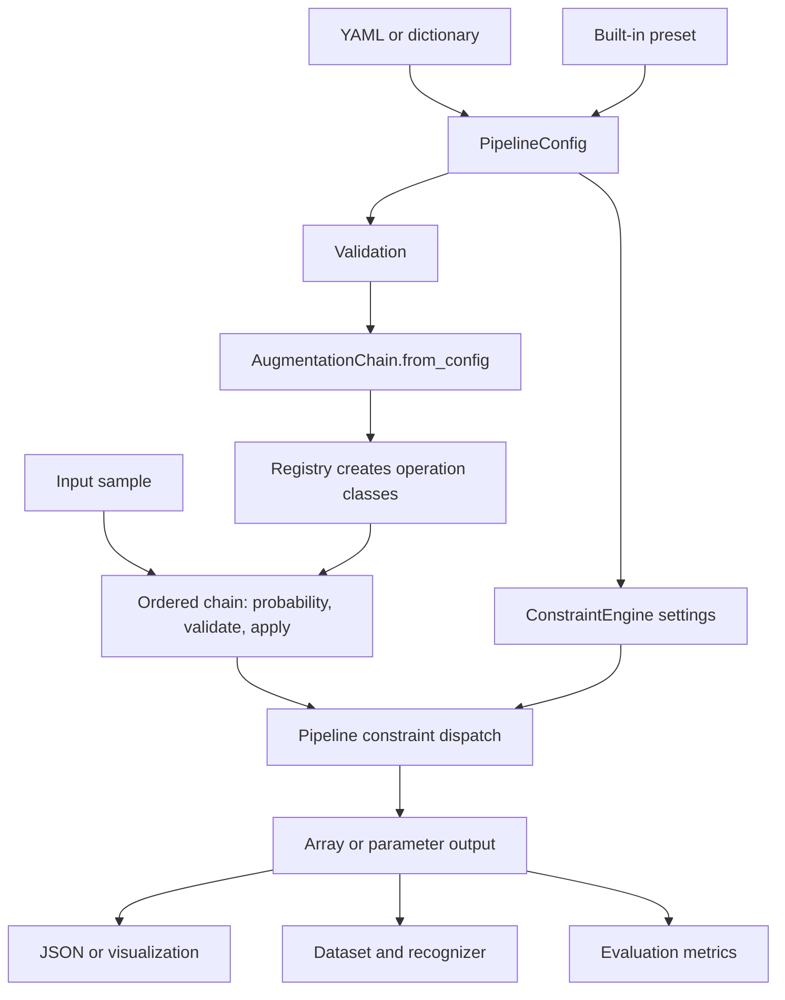

# 2. Follow the actual code

[Guide index](index.md) · Previous: [overview](01-overview.md) · Next: [math and geometry](03-math-and-geometry.md)

This map describes **code present** at `45472c6a1f99e24ac5763eeae7acb3be01ff4886`. Runtime evidence belongs in [project status](05-project-status.md). Follow concrete symbols rather than assuming every feature named in a docstring is wired into the pipeline.

## Start with these imports

```python
from kinetic_augment import Pipeline, PipelineConfig, ConstraintConfig
from kinetic_augment import AugmentationChain, get_preset, list_presets
from kinetic_augment import load_and_reshape_json, save_to_json
```

These exports come from [`kinetic_augment/__init__.py`](../../src/kinetic_augment/__init__.py). Use the installed package name `kinetic_augment`, even though the installable distribution is named `kinetic-augment` in [pyproject.toml](../../pyproject.toml). The source lives under `src/`; `src.kinetic_augment` is not the intended public import convention.

Dataset exports `AugmentedLandmarkDataset`, `LandmarkSequenceDataset`, and `create_data_loaders` depend on optional PyTorch support. The true body model is a separate import:

```python
from kinetic_augment.body_model.smplx_wrapper import SMPLXWrapper
```

Importing that class does not load weights; constructing it requires dependencies and model assets. Core dependencies include NumPy, SciPy, and PyYAML; optional groups in `pyproject.toml` cover PyTorch/SMPL-X and PyBullet. Consult status before choosing an environment.

## Responsibility map

| File or area | Symbols to find | Responsibility |
| --- | --- | --- |
| [pipeline/config.py](../../src/kinetic_augment/pipeline/config.py) | `PipelineConfig`, `ConstraintConfig` | Parse modern YAML/dictionaries, store settings, validate selected settings. |
| [pipeline/presets.py](../../src/kinetic_augment/pipeline/presets.py) | `get_preset`, `PRESET_NAMES` | Construct fresh configurations for `none`, `conservative`, `moderate`, `aggressive`; all default to landmark mode. |
| [pipeline/chain.py](../../src/kinetic_augment/pipeline/chain.py) | `ChainStep`, `AugmentationChain` | Build ordered steps; draw application probabilities; validate input and call each operation. |
| [pipeline/pipeline.py](../../src/kinetic_augment/pipeline/pipeline.py) | `Pipeline` | Build chain and constraint engine, process one sample or a list of samples. |
| [augmentations/base.py](../../src/kinetic_augment/augmentations/base.py) | `AugmentationRegistry`, base classes | Map operation names to classes and define representation-specific validation interfaces. |
| [augmentations/__init__.py](../../src/kinetic_augment/augmentations/__init__.py) and its modules | Class imports and `@AugmentationRegistry.register(...)` | Importing modules executes decorators that populate the registry; modules implement transforms. |
| [body_model/smplx_wrapper.py](../../src/kinetic_augment/body_model/smplx_wrapper.py) | `SMPLXWrapper.forward` | Load the actual body model, convert NumPy inputs to Torch, return NumPy joints/vertices. |
| [body_model/mp_to_smplx.py](../../src/kinetic_augment/body_model/mp_to_smplx.py), [smplx_to_mp.py](../../src/kinetic_augment/body_model/smplx_to_mp.py) | `MediaPipeToSMPLX.fit`, `SMPLXToMediaPipe.project` | Bespoke bone-vector encoding and reconstruction, separate from true SMPL-X fitting. |
| [body_model/joint_mapping.py](../../src/kinetic_augment/body_model/joint_mapping.py) | Joint dictionaries, `clamp_joint_angles` | Names, indices, chain definitions, and default numerical limits. |
| [constraints/engine.py](../../src/kinetic_augment/constraints/engine.py) | `ConstraintEngine`, `ConstraintViolation` | Orchestrate joint, velocity, and optional collision checks/corrections. |
| [constraints/](../../src/kinetic_augment/constraints/index.md) | `JointLimitConstraint`, `VelocityConstraint`, `CollisionConstraint` | Specific correction/check implementations; collision implementation lives in a subpackage. |
| [pipeline/dataset.py](../../src/kinetic_augment/pipeline/dataset.py) | `AugmentedLandmarkDataset`, `LandmarkSequenceDataset` | Apply training augmentation and prepare samples for PyTorch consumers. |
| [evaluation/](../../src/kinetic_augment/evaluation/index.md) | Metrics, datasets, classifiers, trainer, benchmark runner | Measure quality proxies and recognition behavior; these are consumers of augmentation, not its core engine. |
| [utils/data_formats.py](../../src/kinetic_augment/utils/data_formats.py) | Constants, JSON load/save | Define 543-landmark ordering and reshape flattened JSON frames. |
| [canonicalization.py](../../src/kinetic_augment/canonicalization.py) | `to_canonical_space_frame`, sequence helpers | Center, orient, and normalize coordinates, with stored inverse transform information. The modern pipeline does not call it. |

## Configuration to output



Text fallback: YAML/dictionary or preset → config → validation → registry-backed chain. Input → probabilistic ordered transforms → optional constraint dispatch → output. Consumers may save, visualize, train, or evaluate it; `Pipeline.process` itself returns data, not a class prediction or a report.

`PipelineConfig.from_yaml` uses `yaml.safe_load`, then `from_dict` reads known fields ([config.py](../../src/kinetic_augment/pipeline/config.py), lines 146–189). Unknown top-level keys are not automatically implemented features. `AugmentationChain.from_config` reads each step's `operation`, `probability`, and `params` ([chain.py](../../src/kinetic_augment/pipeline/chain.py), lines 230–271). The registry creates the class with `params` as its constructor config ([base.py](../../src/kinetic_augment/augmentations/base.py), lines 292–326).

At processing time, the chain draws a probability for each step, skips inputs that fail that operation's `validate`, and passes the current result into `apply` ([chain.py](../../src/kinetic_augment/pipeline/chain.py), lines 151–181). A step listed in `get_info()` is therefore not proof it changed the input. `apply_deterministic` controls step selection, but transform internals can still sample random values.

## Representation contracts

Let `T` denote frames, `J` landmarks, and `B` model batch elements. A batch dimension is not automatically a time dimension.

| Boundary | Expected structure | Important detail |
| --- | --- | --- |
| Landmark augmentation | NumPy `(T, J, 3)` | Base validation checks rank and last dimension, not ordering, units, missing values, or anatomy. |
| Repository JSON | List of frames, each 1,629 values | Load reshapes to `(T, 543, 3)`, float32. Save flattens each frame. |
| Standard `body_pose` | `(B, 63)`, often `(63,)` accepted by intrinsic operations | 21 body rotations × 3 components; excludes pelvis/global orientation. |
| Standard hand pose, default full rotation form | `(B, 45)` per hand | 15 hand rotations × 3; wrapper PCA mode uses a different size. |
| Standard shape/orientation | `betas: (B, 10)` by default; `global_orient: (B, 3)` | Model configuration can change shape dimension; translation is a separate `(B, 3)` parameter. |
| Temporal parameter sequence | List of frame dictionaries | Temporal base validation accepts lists/arrays, not one dictionary; intrinsic base validation accepts dictionaries, not lists. |
| `Pipeline.process_batch` | Python list of individual samples | Loops over `process`; not a vectorized `(N, T, J, 3)` call. |
| Dataset output | Float32 Torch tensor or NumPy sample; optionally paired with label | `num_augmented_versions` expands virtual indices; the dataset reuses the base label. |

The local 543-landmark ordering is pose `0:33`, face `33:501`, left hand `501:522`, right hand `522:543` ([data_formats.py](../../src/kinetic_augment/utils/data_formats.py), lines 9–20). This is legacy Holistic's 33 + 468 + 21 + 21 layout, not 543 anatomical joints. [Official Holistic reference](https://github.com/google-ai-edge/mediapipe/blob/master/docs/solutions/holistic.md).

Three coordinate values do not necessarily mean meters. MediaPipe distinguishes normalized image landmarks from world coordinates. This checkout's `MediaPipeExtractor._extract` reads `pose_landmarks`, face, and hand `x/y/z`, not `pose_world_landmarks` ([render_landmarks.py](../../scripts/render_landmarks.py), lines 54–68). Do not interpret a numerical amplitude as a physical displacement without confirming the input convention. [Official Pose Landmarker coordinate overview](https://developers.google.com/edge/mediapipe/solutions/vision/pose_landmarker).

The bone-vector encoder uses pose-shaped `(B, 63)`/`(B, 45)` arrays too, but their contents are displacements. Read chapter 1's warning before combining these routes. Shape compatibility is weaker than meaning compatibility.

## Extrinsic and intrinsic routes are not automatic conversions

In **landmark mode**, extrinsic classes receive arrays directly. The chain rejects intrinsic `SMPLXAugmentation` classes at construction, regardless of their probability. After processing, landmark constraint dispatch returns data unchanged ([pipeline.py](../../src/kinetic_augment/pipeline/pipeline.py), lines 148–158).

In **SMPL-X mode**, configuration requires a `smplx_model_path`, but `Pipeline.__init__` does not instantiate a wrapper from that path. Supply a wrapper explicitly when the required operation needs real model geometry. Intrinsic classes can modify a parameter dictionary numerically without evaluating a mesh. `Pipeline.process` also does not automatically call `wrapper.forward` to produce output landmarks.

The chain permits a landmark class in SMPL-X mode with a comment about applying after forward kinematics; the implementation contains no such conversion. Given a dictionary, the landmark validator rejects it and the chain silently skips the operation ([chain.py](../../src/kinetic_augment/pipeline/chain.py), lines 123–181).

Similarly, a list supports temporal operations and sequence constraints, while intrinsic validators reject that list. A dictionary supports intrinsic operations, while temporal validators reject it. **Inference:** a plan mixing intrinsic and temporal operations needs explicit orchestration consistent with each input type; selecting `mode='smplx'` does not make every step execute.

For a dictionary, constraint dispatch calls `ConstraintEngine.enforce(data)` without previous-frame information. For a list, it calls `enforce_sequence(data, dt)` ([pipeline.py](../../src/kinetic_augment/pipeline/pipeline.py), lines 141–146). Engine enforcement orders joint limits → velocity correction when a previous frame exists → collisions ([engine.py](../../src/kinetic_augment/constraints/engine.py), lines 193–262). `canonicalize` and `output_space` are stored config fields, but the modern process method does not consume them.

## One concrete sample traced through source

This deliberately small **source-level example** isolates uniform scaling. It does not use a dataset, licensed weights, or a checked-in task profile. It is not an SLR-validity experiment.

```python
import numpy as np
from kinetic_augment import Pipeline

clip = np.zeros((2, 543, 3), dtype=np.float32)
clip[:, 11, :] = [1.0, 2.0, 3.0]  # pose landmark 11: left shoulder
pipeline = Pipeline.from_dict({
    'mode': 'landmark',
    'plan': [{
        'operation': 'GlobalScaling',
        'probability': 1.0,
        'params': {'scale_range': [2.0, 2.0]},
    }],
    'constraints': {
        'joint_limits': False,
        'velocity_limits': False,
        'collision_detection': False,
    },
})
scaled = pipeline.process(clip)
# Expected from source: scaled.shape == (2, 543, 3)
# scaled[:, 11, :] contains [2.0, 4.0, 6.0] for each frame.
```

1. `Pipeline.from_dict` calls `PipelineConfig.from_dict`, then the constructor ([pipeline.py](../../src/kinetic_augment/pipeline/pipeline.py), lines 235–252).
2. Config validation recognizes `GlobalScaling`; the constructor builds the chain. With all constraint flags false, `_build_constraint_engine` returns `None` (same file, lines 71–96).
3. `AugmentationChain.from_config` passes `[2.0, 2.0]` to registry-created `GlobalScaling` ([chain.py](../../src/kinetic_augment/pipeline/chain.py), lines 259–271; [base.py](../../src/kinetic_augment/augmentations/base.py), lines 315–321).
4. `process` calls the chain. Probability 1.0 selects the step; `(2, 543, 3)` passes `LandmarkAugmentation.validate` ([base.py](../../src/kinetic_augment/augmentations/base.py), lines 114–122).
5. `GlobalScaling.apply` samples within the fixed interval, then returns `data * scale_factor` ([extrinsic.py](../../src/kinetic_augment/augmentations/extrinsic.py), lines 118–125). Thus every coordinate doubles and the input shape remains.
6. With no engine, process returns that array. `save_to_json` could flatten it; a dataset wrapper could pair it with the original label. Neither consumer proves that doubling is a valid augmentation for a real sign.

Replacing the fixed interval with `[0.95, 1.05]` makes the scale random. The chain seed controls its probability generator; transform internals use global `np.random`. Do not infer full reproducibility solely from `Pipeline.reset_seed`. Detailed checks belong in status.

## Legacy alternatives and misleading entry points

| Path | What to know before copying it |
| --- | --- |
| [`pipeline_legacy.py`](../../src/kinetic_augment/pipeline_legacy.py) | Top-level `from kinetic_augment import AugmentationPipeline` exports this deprecated class. It canonicalizes, uses a map of function-style transforms, and optionally inverts canonicalization (lines 39–112). |
| [`augmentations.py`](../../src/kinetic_augment/augmentations.py) beside `augmentations/` | Old function-style file coexists with the class package. The legacy code references functions through `.augmentations`; do not assume this imports the old file rather than the package. Status checks this compatibility. |
| [`examples/run_augmentation.py`](../../examples/run_augmentation.py) | Imports `AugmentationPipeline` from `src.kinetic_augment.pipeline`; the modern `pipeline/__init__.py` does not export that symbol. Its command-line shape is historical guidance, not a verified modern entry point. |
| [`configs/slr_profile.yaml`](../../configs/slr_profile.yaml), [`har_running_profile.yaml`](../../configs/har_running_profile.yaml), [`slr_profile_extended.yaml`](../../configs/slr_profile_extended.yaml) | Contain task intentions, older names, and mixed representations. Modern config defaults to landmark mode; an unknown operation or intrinsic operation in that mode fails construction even when its probability is zero. Consult status before use. |
| [`scripts/render_augmented_from_yaml.py`](../../scripts/render_augmented_from_yaml.py) | Defines its own function map and processing logic. Rendering an augmentation here does not verify the modern class pipeline. |
| [`pyproject.toml`](../../pyproject.toml) | Declares `kinetic-augment = kinetic_augment.cli:main`, but no `cli.py` exists in this snapshot. Do not start with that installed command. |

For example, modern `JointAnglePerturbation` reads `stddev` and `joint_groups` ([intrinsic.py](../../src/kinetic_augment/augmentations/intrinsic.py), lines 71–80). Older profiles use keys such as `noise_stddev_rad` and `joint_group`; retaining those keys does not ensure the intended settings are used. Top-level profile `joint_limits`, `kinematic_chains`, and environmental declarations are not automatically translated into modern `constraints` configuration.

Use the installed `Pipeline` API with an explicit compatible configuration as the clearest source navigation route. Phase scripts and tests help locate intended workflows, but their existence is not evidence that all paths or optional assets were exercised. Continue to [math](03-math-and-geometry.md), [data and evaluation](04-data-training-evaluation.md), and [status](05-project-status.md) for the corresponding detail.
