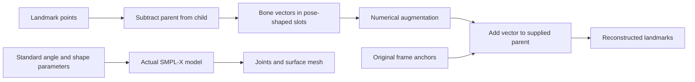

# 3. Geometry that changes motion

[Guide index](index.md) · Previous: [code map](02-code-map.md) · Next: [data, training and evaluation](04-data-training-evaluation.md)

Geometry gives transformations meaning. It tells us whether three numbers describe a point, a displacement, or a rotation; those meanings determine which operations make sense. This chapter explains **code present** at source snapshot `45472c6a1f99e24ac5763eeae7acb3be01ff4886` (2026-05-08), audited 2026-10-01. Worked calculations below are teaching examples and source deductions. Runtime verification is documented in [project status](05-project-status.md).

Read sections 1–3 before trying intrinsic augmentation. Sections 4–6 explain time and constraints. Every excerpt labeled **verbatim** reproduces the indicated source lines with only common leading indentation removed. Snippets are fragments of methods, not standalone programs.

## 1. Three numbers, three different meanings

A **point** p says where a landmark is in a chosen coordinate system. A **bone vector** d = child − parent says how to travel between two points. Translating both points changes p but leaves d unchanged. A **rotation vector**, also called an axis-angle vector, says how to rotate: r = angle × unit_axis. Its length is the angle in radians, rather than the physical length of a limb. For example, `[0, 0, π/2]` rotates 90° about z; it does not move a joint upward by 1.57 units. [SciPy's rotation-vector definition](https://docs.scipy.org/doc/scipy/reference/generated/scipy.spatial.transform.Rotation.from_rotvec.html).

| Quantity | Example | Units/interpretation | Natural operations |
| --- | --- | --- | --- |
| Point | shoulder `[1,2,0]` | Input coordinate units | Translate, rotate, scale |
| Bone vector | elbow − shoulder `[0.3,0,0]` | Same coordinate units as points | Rotate direction, scale length |
| Rotation vector | `[0,0,1.5708]` | Angle in radians, direction is rotation axis | Convert to rotation, compose rotations |
| Shape coefficient | `betas[0]=0.5` | Coefficient in a learned body-shape space | Add a coefficient change, then evaluate model |

For a true rotation matrix R, `R.T @ R = I` and `det(R) = +1`. It preserves lengths and angles: `||R d|| = ||d||`. A 90° z rotation maps `[1,0,0]` to `[0,1,0]`. **Composition** means apply one rotation after another; generally `R2 @ R1` differs from `R1 @ R2`. Adding arbitrary axis-angle triples is only a local approximation to composition, not its exact rule.

The standard SMPL-X model maps pose, shape, and expression parameters to joints and a surface mesh. **Forward kinematics** propagates local rotations through a parent-child tree: a forearm's world orientation depends on its own joint and all ancestors. **Skinning** blends those joint transformations to move surface vertices; SMPL-X also includes learned deformations. This is the conceptual body-model layer, not what every conversion function in this repository computes. [SMPL-X paper and model project](https://smpl-x.is.tue.mpg.de/).

A useful distinction is **representation validity** versus **anatomical validity**. A correctly sized `(1,63)` tensor may still contain displacement vectors where a model expects angles. A valid set of angles may still describe a collision or an inappropriate sign. Shape validation alone establishes neither.

### Walkthrough A: the active encoder stores displacement

**Verbatim excerpt:** [`MediaPipeToSMPLX._encode_body`](../../src/kinetic_augment/body_model/mp_to_smplx.py), lines 121–131.

```python
def _encode_body(self, L: np.ndarray) -> np.ndarray:
    """Store each bone vector (child - parent) in the corresponding slot."""
    pose = np.zeros(63, dtype=np.float32)
    for parent_mp, child_mp, child_smplx in BODY_BONES:
        p = L[self.mp[parent_mp]]
        c = L[self.mp[child_mp]]
        slot = _body_pose_slot(child_smplx)
        if slot is not None:
            # Store the raw bone vector: direction + length in one vec3
            pose[slot*3 : slot*3+3] = c - p
    return pose
```

- Line 121 receives one frame's pose block `L: (33,3)`, already sliced by `fit`.
- Lines 123–124 allocate 21 triples and loop over eight named limb segments. Unwritten triples stay zero.
- Lines 125–126 fetch two `(3,)` points using MediaPipe indices. Missing points are not excluded here.
- Line 127 resolves the SMPL-X-shaped storage slot. `_body_pose_slot` subtracts one because pelvis/global orientation is excluded from `body_pose`.
- Lines 128–130 place `c − p` into exactly three adjacent entries. No normalization, rest-pose alignment, rotation conversion, optimization, or model evaluation occurs.
- Line 131 returns `(63,)`. `fit` puts this into `(B,63)` and similarly fills hand arrays `(B,45)`; it creates zero `global_orient` and `betas` (lines 92–119).

Example: shoulder `[1,2,0]`, elbow `[1.3,2,0]` produces `[0.3,0,0]`. The encoder means a length-0.3 displacement along x. Standard SMPL-X would mean a 0.3-radian rotation about x. It cannot recover that displacement merely by interpreting it as an angle. The function name `fit` does not make this an inverse-fitting optimizer.

The module explicitly describes this as bespoke encoding (lines 22–25). Its phrase “exact” round-trip must be scoped: supplied original anchors and matching chains allow reconstruction of driven coordinates; that does not establish correspondence to an anatomical mesh or valid semantic augmentation.

### Walkthrough B: reconstruction adds the stored vector

**Verbatim excerpt:** [`SMPLXToMediaPipe._reconstruct_body`](../../src/kinetic_augment/body_model/smplx_to_mp.py), lines 138–155.

```python
out = original_pose.copy()

for parent_idx, child_idx, smplx_name in BODY_BONES:
    slot = _body_pose_slot(smplx_name)
    if slot is None:
        continue

    bone_vec = body_pose[slot*3 : slot*3+3]

    if np.linalg.norm(bone_vec) < 1e-8:
        # Undriven — preserve relative to (possibly updated) parent
        orig_bone   = original_pose[child_idx] - original_pose[parent_idx]
        out[child_idx] = out[parent_idx] + orig_bone
    else:
        # Driven — attach stored bone vector to current parent
        out[child_idx] = out[parent_idx] + bone_vec

return out
```

- Line 138 copies original pose points, so shoulders, hips, and other undriven points start at their supplied coordinates.
- Lines 140–143 traverse parent-before-child segments, looking up the same storage slots as the encoder. The order matters when an elbow moves before its wrist.
- Line 145 reads one `(3,)` displacement. Lines 147–150 treat a tiny vector as undriven: retain the original displacement relative to the potentially updated parent. The code is more precise than the docstring's “keep original child position.”
- Lines 151–153 attach a nonzero vector directly to the parent's current coordinate. Line 155 returns the copied-and-updated `(33,3)` block.

If the first upper-arm vector becomes `[0,0.3,0]`, the elbow moves to `[1,2.3,0]`. With forearm `[0.2,0,0]`, the new wrist is `[1.2,2.3,0]`. The forearm did not inherit a 90° rotation: it retained its stored world displacement. This is additive chain reconstruction, not standard rotational forward kinematics.

`project` requires `target_mp: (B,543,3)` as the anchor/template. It copies face landmarks and reconstructs the hand blocks from their own original hand anchors (lines 94–123). It never calls the wrapper supplied to its constructor (lines 67–68). Changes to `betas` or `global_orient` have no effect through this projector. Moving the body's pose wrist also does not automatically translate the separate 21-point hand block to that wrist. These are **source-supported limitations**, not observations from a licensed model run.

A further contract mismatch: the encoder's hand slots follow thumb, index, middle, ring, pinky ([mp_to_smplx.py](../../src/kinetic_augment/body_model/mp_to_smplx.py), lines 63–69), whereas `HandPosePerturbation.FINGER_JOINT_INDICES` follows index, middle, pinky, ring, thumb ([intrinsic.py](../../src/kinetic_augment/augmentations/intrinsic.py), lines 187–193). Thus the intrinsic operation's “thumb” weights do not address the encoder's thumb slots. Treat those names as standard-model conventions, not a compatible handshape-preservation guarantee for the bespoke route.



Text fallback: the bespoke path subtracts points → edits displacement slots → adds displacements to original anchors. The separate standard path evaluates valid SMPL-X parameters through the actual model. A matching dictionary shape does not connect the meanings of these two paths.

## 2. Canonicalization: choosing a body-centered coordinate frame

**Canonicalization** removes selected differences in position, orientation, and scale so samples can be compared. Here it centers on the shoulder midpoint, uses shoulders and nose to build orthogonal axes, and makes shoulder width one. This is useful for studying whether camera framing is a nuisance; it can also erase information or amplify detector noise. The modern `Pipeline.process` does not call these utilities merely because config has `canonicalize=True`; they belong to a utility/legacy path. See [chapter 2](02-code-map.md).

Write the transformed point as `q = s R.T (p − t)`: subtract shoulder midpoint t, rotate into the constructed frame, then scale by s = 1/shoulder_width. The stored inverse is `p = R (q/s) + t`. Operation order matters: inversion reverses the sequence.

### Walkthrough C: build orthogonal body axes

**Verbatim excerpt:** [`to_canonical_space_frame`](../../src/kinetic_augment/canonicalization.py), lines 35–50.

```python
centered_pose = centered_landmarks[POSE_START:POSE_END]
x_vec = centered_pose[RIGHT_SHOULDER] - centered_pose[LEFT_SHOULDER]
if np.linalg.norm(x_vec) < 1e-6: return frame_landmarks, None

x_axis = x_vec / np.linalg.norm(x_vec)
y_vec = centered_pose[NOSE] - ((centered_pose[LEFT_SHOULDER] + centered_pose[RIGHT_SHOULDER]) / 2.0)
if np.linalg.norm(y_vec) < 1e-6: return frame_landmarks, None

z_axis = np.cross(x_axis, y_vec); z_axis /= np.linalg.norm(z_axis)
y_axis = np.cross(z_axis, x_axis); y_axis /= np.linalg.norm(y_axis)

rotation_matrix = np.array([x_axis, y_axis, z_axis]).T
original_rotation = Rotation.from_matrix(rotation_matrix)

aligning_rotation = original_rotation.inv()
oriented_landmarks = aligning_rotation.apply(centered_landmarks)
```

- Line 35 slices the centered `(33,3)` pose block. Lines 36–39 create the shoulder direction and divide by its Euclidean norm. A unit vector has length one.
- Lines 40–41 create a rough upward direction from shoulder midpoint toward nose. This vector need not be perpendicular to the shoulders.
- Line 43 uses the **cross product**, which is perpendicular to both input directions, to construct z. It then normalizes z.
- Line 44 constructs y from z and x, replacing the rough upward direction with an orthogonal one. Together these are a local coordinate basis.
- Line 46 stacks the axes as columns in a `(3,3)` matrix. Line 47 wraps it as a SciPy rotation. Lines 49–50 apply the inverse rotation to all `(543,3)` points.

For shoulders `[1,2,0]` and `[3,2,0]`, nose `[2,3,0]`, midpoint is `[2,2,0]`, axes are the usual x/y/z, width is 2, and s is 0.5. Canonical shoulders are `[-0.5,0,0]` and `[0.5,0,0]`; nose is `[0,0.5,0]`. Inversion restores those input coordinates.

Lines 22 and 62 preserve all-zero missing detections. However, the early midpoint check does not require *both* shoulders to be detected. A valid centered point exactly at zero also shares the missing-point sentinel; the inverse's zero mask can erase it. Another **inference from source**: nose and shoulder directions can be nonzero yet parallel, producing a zero cross product and division by zero at line 43. Existing norm guards do not test that case. Frame-by-frame axes may jitter as detection noise changes; stored transforms make inversion possible but do not smooth the axes. The relevant SciPy matrix/rotation API is linked through [its Rotation reference](https://docs.scipy.org/doc/scipy/reference/generated/scipy.spatial.transform.Rotation.html).

## 3. Augmentation parameters shared through time

A clip has shape `(T,J,3)`. A coherent camera rotation should use the same sampled rotation for every frame of that clip; sampling a new camera angle every frame would introduce artificial shaking.

### Walkthrough D: flatten, rotate, restore

**Verbatim excerpt:** [`GlobalRotation.apply`](../../src/kinetic_augment/augmentations/extrinsic.py), lines 90–96.

```python
rotation = Rotation.from_euler('xyz', [rx, ry, rz], degrees=True)

num_frames, num_landmarks, _ = data.shape
reshaped = data.reshape(-1, 3)
rotated = rotation.apply(reshaped)

return rotated.reshape(num_frames, num_landmarks, 3)
```

- Line 90 constructs one rotation from the three angles drawn on lines 77–88. Lowercase `xyz` in SciPy means extrinsic fixed-axis Euler rotations, with `degrees=True` specifying input units. [Official Euler API](https://docs.scipy.org/doc/scipy/reference/generated/scipy.spatial.transform.Rotation.from_euler.html).
- Line 92 remembers T and J. Line 93 reshapes `(T,J,3)` into `(T×J,3)`; for `(2,543,3)`, that is `(1086,3)`.
- Line 94 applies the same rotation to every row. This is a constant transformation across time without explicitly allocating T copies of a matrix.
- Line 96 restores `(T,J,3)`. The coordinates are rotated about origin; the function does not first center on the body.

Likewise `GlobalScaling.apply` samples one scalar then multiplies the entire clip ([extrinsic.py](../../src/kinetic_augment/augmentations/extrinsic.py), lines 118–125). This preserves relative bone lengths within that clip up to the same scale. It does not establish viewpoint or scale invariance for sign labels. Image-normalized x/y and model-specific depth estimates also do not form a calibrated Euclidean world merely because an array has three columns.

Do not generalize this time-sharing rule to intrinsic classes. `JointAnglePerturbation` draws noise *inside* its batch-row loop ([intrinsic.py](../../src/kinetic_augment/augmentations/intrinsic.py), lines 125–142). Calling the encoder on a `(T,543,3)` array treats T frames as B independent rows. The intrinsic operation can then sample a different perturbation for each frame. `BodyProportionVariation` also changes coefficients per batch row (lines 478–485). The current dictionaries contain no explicit marker that a batch means one temporal sequence.

## 4. Time warping and interpolation

A temporal warp changes **which source time** supplies each output frame. With source positions at time 1 and 2, sampling at 1.25 uses `0.75*p1 + 0.25*p2` under linear interpolation. For scalar positions 2 and 6, the result is 3. A three-dimensional point is interpolated one coordinate at a time.

### Walkthrough E: construct a time map

**Verbatim excerpt:** [`TimeWarping._create_warp_curve`](../../src/kinetic_augment/augmentations/temporal.py), lines 135–158.

```python
knot_x = np.linspace(0, num_frames - 1, self.num_knots)
knot_y_offsets = (
    np.random.uniform(-1, 1, size=self.num_knots) *
    self.max_warp_factor * num_frames
)

# Fix endpoints if requested
if self.preserve_endpoints:
    knot_y_offsets[0] = 0
    knot_y_offsets[-1] = 0

# Create spline
spline = CubicSpline(knot_x, knot_x + knot_y_offsets)
t_warped = spline(np.arange(num_frames))

# Ensure monotonic and within bounds
t_warped = np.clip(t_warped, 0, num_frames - 1)

# Ensure strictly increasing (fix any inversions)
for i in range(1, len(t_warped)):
    if t_warped[i] <= t_warped[i-1]:
        t_warped[i] = t_warped[i-1] + 0.01

return t_warped
```

- Line 135 distributes control-point times through `[0,T−1]`. Lines 136–139 draw source-time offsets of magnitude up to `max_warp_factor*T`; their units are frame indices.
- Lines 142–144 set endpoint offsets to zero when requested. Line 147 fits a cubic spline through the perturbed times, and line 148 samples that spline at each output index.
- Line 151 clips the sampled map to available source frames. Lines 154–156 repair non-increasing neighboring times by adding 0.01 frames. Line 158 returns a `(T,)` map.

A **cubic spline** joins cubic polynomial pieces with continuous first and second derivatives. Smoothness does not guarantee that its values increase, which explains the repair. [SciPy CubicSpline](https://docs.scipy.org/doc/scipy/reference/generated/scipy.interpolate.CubicSpline.html). Since repair happens *after* clipping, a repaired value can exceed `T−1`, including an endpoint originally fixed there. The map is therefore not guaranteed both strictly increasing and in bounds. One-frame clips also give repeated knot x values, outside CubicSpline's increasing-input requirement.

The landmark resampler loops over J and 3 coordinates using `np.interp` ([temporal.py](../../src/kinetic_augment/augmentations/temporal.py), lines 75–91). Output remains `(T,J,3)`. With its default bounds behavior, NumPy supplies endpoint values outside the source range. A smooth time map therefore does not imply smooth derivatives of the resulting piecewise-linear coordinate trajectory. [NumPy interpolation API](https://numpy.org/doc/stable/reference/generated/numpy.interp.html).

For parameter dictionaries, the code instead linearly blends each NumPy-valued key `(1−alpha)*v1 + alpha*v2` (lines 119–128). That is sensible as an arithmetic rule for displacements, although it can shorten a bone. It is not rotation-aware interpolation of true SMPL-X angles. For rotations, **spherical interpolation** follows a rotational path rather than averaging angle coordinates; SciPy provides [Slerp](https://docs.scipy.org/doc/scipy/reference/generated/scipy.spatial.transform.Slerp.html). It is a conceptual alternative here, not a feature used by this implementation.

`SpeedVariation` has a particularly useful source-reading lesson. In `'proportional'` mode, `out_frames = int(T/speed)`: speed 2 roughly halves the frame count. In the default `'same'` mode, output and input both use the identical `linspace(0,1,T)`; sampled speed never changes those grids ([temporal.py](../../src/kinetic_augment/augmentations/temporal.py), lines 205–228). For ordinary T≥2 clips this is effectively identity resampling, rather than a speed change. `FrameDropping` removes observations then interpolates back to original length (lines 315–343), retaining endpoints. These distinctions affect both experiment interpretation and batching.

## 5. Constraints: approximations with assumptions

A **constraint** says which outputs are allowed. A hard constraint ensures the final value is inside a permitted set. A soft correction moves toward that set without necessarily reaching it. Numerical limits are useful checks, but their coordinate convention must match the representation.

`JointLimitConstraint.enforce` clips each axis-angle component independently using `clamp_joint_angles` ([joint_limits.py](../../src/kinetic_augment/constraints/joint_limits.py), lines 149–178). The permitted set is a box in three numerical components. Axis-angle components are not independent anatomical flexion/abduction/twist angles; component clipping is therefore an approximation even for standard angles. For bone-vector slots it clips displacement using angular thresholds, which has no justified anatomical interpretation. `check` examines only batch row 0 (lines 95–96), while enforcement iterates all rows (lines 167–172).

**Angular velocity** measures change in rotation per second. This implementation estimates it as `||r_t − r_previous|| / dt` rather than computing relative rotations. The local approximation becomes misleading near representation discontinuities: two rotation vectors can be numerically far apart but represent close rotations. With displacement slots the same calculation is displacement-change per second, not rad/s. `dt` must be a positive, correct frame interval.

### Walkthrough F: velocity correction is a blend

**Verbatim excerpt:** [`VelocityConstraint.enforce`](../../src/kinetic_augment/constraints/velocity_limits.py), lines 225–239.

```python
delta = current_angles - prev_angles
delta_magnitude = np.linalg.norm(delta)

if delta_magnitude > max_delta:
    # Scale delta to max velocity
    scale = max_delta / delta_magnitude
    limited_delta = delta * scale

    # Blend between original and limited
    blended_delta = (
        self.smoothing_factor * limited_delta +
        (1 - self.smoothing_factor) * delta
    )

    current_pose[b, pose_idx:pose_idx + 3] = prev_angles + blended_delta
```

- Lines 225–226 subtract current and previous triples and measure their norm. Both are `(3,)` for one joint and batch row.
- Line 228 compares that norm with `max_delta = max_velocity*dt`, computed on line 217.
- Lines 230–231 scale the delta to exactly the permitted magnitude, preserving its direction.
- Lines 234–237 mix that limited delta with the original delta. With smoothing factor a, the mixture is `a*limited + (1−a)*original`.
- Line 239 adds the mixed delta to the previous triple, producing the corrected current value.

For original magnitude 1 rad, dt=1/30 s, max velocity=10 rad/s, the limited delta is 1/3 rad. Default a=0.7 gives `0.7/3+0.3=0.5333` rad, hence 16 rad/s. **Inference:** one application reduces speed but still exceeds the requested maximum; it becomes a hard cap only at a=1 for this case. The class description's “ensures” language is stronger than that arithmetic supports. Its `check` also reads row 0 (lines 151–152).

Engine sequence enforcement uses the previous corrected frame when moving forward ([engine.py](../../src/kinetic_augment/constraints/engine.py), `enforce_sequence`, lines 249–260). This can accumulate changes through time. Correction order can also matter: fixing a collision after velocity adjustment can introduce a new temporal jump. Landmark-mode pipeline dispatch currently returns landmarks unchanged by the constraint engine; a configuration checkbox does not override that implementation gap.

## 6. Collision proxies and heuristic resolution

Collision detection asks whether two occupied volumes overlap. A **proxy** simplifies that volume: here limbs/torso use capsules (a cylinder with rounded ends) and selected parts use spheres, derived from joint positions and nominal body dimensions. These can miss fine finger/mesh contacts or flag harmless near-contact. Static/kinematic PyBullet bodies are positioned explicitly; this is not a simulation of gravity, muscles, ground reaction forces, or joint torque ([collision_checker.py](../../src/kinetic_augment/constraints/collision/collision_checker.py), lines 150–157, 162–208).

The checker excludes selected adjacent pairs and tolerates selected intended contacts. It only uses the first row of batched joint positions (lines 181–183). Capsules are repositioned/oriented but their initial lengths are not dynamically rebuilt (lines 192–201). Thus a changed body shape may not be matched by changed proxy size.

### Walkthrough G: signed distance becomes penetration depth

**Verbatim excerpt:** [`CollisionChecker.check_collisions`](../../src/kinetic_augment/constraints/collision/collision_checker.py), lines 237–256.

```python
contact_points = p.getClosestPoints(
    body_a,
    body_b,
    distance=0.01,  # Small margin for near-misses
    physicsClientId=self.physics_client,
)

if contact_points:
    # Get maximum penetration depth
    # contact_points[i][8] is the contact distance (negative = overlap)
    min_distance = min(cp[8] for cp in contact_points)

    # Get contact tolerance for this pair
    tolerance = get_contact_tolerance(part_a, part_b)

    # Penetration depth (positive = overlap beyond tolerance)
    depth = -min_distance - tolerance

    if depth > 0:
        collisions.append((part_a, part_b, depth))
```

- Lines 237–242 query nearby points within distance 0.01, in the same distance units as the geometry. This includes near misses, despite the earlier comment mentioning zero distance.
- Lines 244–247 select the minimum signed contact distance at tuple index 8. Negative distance means overlap. The official [PyBullet Python binding](https://raw.githubusercontent.com/bulletphysics/bullet3/master/examples/pybullet/pybullet.c) constructs this tuple in `MyConvertContactPoint`; `get_contact_points`' local comment about indices is stale, while its actual index reads use 7 for normal and 8 for distance.
- Line 250 obtains pair-specific permitted penetration. Line 253 turns signed distance into positive overlap beyond that tolerance.
- Lines 255–256 report only depth greater than zero. A signed distance −0.02 with tolerance 0.005 reports depth 0.015; positive separation does not qualify.

Those numbers can mean meters only with correctly scaled world/model joints, not uncalibrated landmark image coordinates. A real wrapper/model is needed for the collision constraint's parameter-to-joint route; the bone-vector projector does not supply that model semantics.

`GradientResolver` is named like an optimizer but does not use autograd. It chooses up to three controlling joints, sets magnitude `min(contact.depth*2, step_size)`, and heuristically maps normal `[nx,ny,nz]` to angle delta proportional to `[nz,nx,−ny]` ([resolution.py](../../src/kinetic_augment/constraints/collision/resolution.py), lines 172–217, 274–298). The coefficient converts distance numerically into a rotation adjustment without a biomechanical derivation. The checker stores PyBullet's normal, which points from B toward A, but resolver comments assume A toward B; it also labels tuple index 5 as position on B although PyBullet supplies position on A ([collision_checker.py](../../src/kinetic_augment/constraints/collision/collision_checker.py), lines 291–306). These source/API mismatches need checking before interpreting the correction as pushing parts apart. A **Jacobian** would describe how small angle changes move contact points; this resolver's own comments say that mapping is omitted. With both wrapper and checker it reevaluates contacts for up to 10 iterations (lines 130–149); otherwise it makes a single correction. It can stop without a guarantee of eliminating collisions, and applies each contact adjustment to every batch row.

## 7. Inverse fitting versus classifier training

It is useful to know what true fitting would mean before reading older project descriptions. **Inverse fitting** keeps a pretrained body model fixed and searches for one observation's pose/shape/camera parameters. A conceptual loss is:

`L_fit = mean(weight * (predicted_corresponding_joints − target_joints)^2) + λ*mean(pose^2)`.

The squared term rewards agreement; the regularizer discourages implausibly large parameter values. If K correspondences have shape `(B,K,3)` and weights `(K,)`, `weights[None,:,None]` has shape `(1,K,1)` and broadcasts across batch and coordinate axes. Weight 2 doubles that joint's squared-error contribution. Targets need a compatible coordinate system, scale and joint correspondence; normalized image landmarks cannot simply be called metric 3D targets.

**Autograd** records differentiable tensor operations and applies the chain rule to obtain loss derivatives. A pose optimizer would update pose tensors with `requires_grad=True`, while classifier training updates shared network weights to predict labels across many clips. [PyTorch autograd tutorial](https://docs.pytorch.org/tutorials/beginner/basics/autogradqs_tutorial.html). The two tasks have different optimized variables and different evidence requirements.

**Historical code, not current behavior:** the parent of commit `f9c6d7b` (2026-05-08) had an Adam fitting loop, `_compute_loss`, `_initialize_params`, and `fit_sequence`. Inspect it with `git show f9c6d7b^:src/kinetic_augment/body_model/mp_to_smplx.py`. Its sequence method used the previous result as initialization, called a **warm start**; that is not the same as adding a temporal penalty. The `smoothing_weight` argument was present but unused. This historical code's imported initial tensors also were not explicitly re-enabled for gradients. These are source descriptions, not a claim that the older path was validated.

At the current snapshot those fitting helpers, `fit_sequence`, and `SimpleFitter` are absent. Current `fit` runs the encoder shown above. The retained real `SMPLXWrapper.forward` evaluates `self.model` inside `torch.no_grad()` and returns NumPy arrays ([smplx_wrapper.py](../../src/kinetic_augment/body_model/smplx_wrapper.py), lines 205–220), so that convenience API itself cannot supply a differentiable fitting loss. A future optimizer would need an appropriate Torch/model path and verified parameter semantics; restoring a function name would not establish correctness.

No custom CUDA kernels, `einsum` implementation, `DistributedDataParallel`, or `torch.distributed` training was found in the inspected runtime source inventory/search. Ordinary Torch device selection exists; GPU execution and distributed performance are not demonstrated here. Study the real NumPy/SciPy transformations and PyTorch recurrent training in [chapter 4](04-data-training-evaluation.md) before imagining those absent systems.
