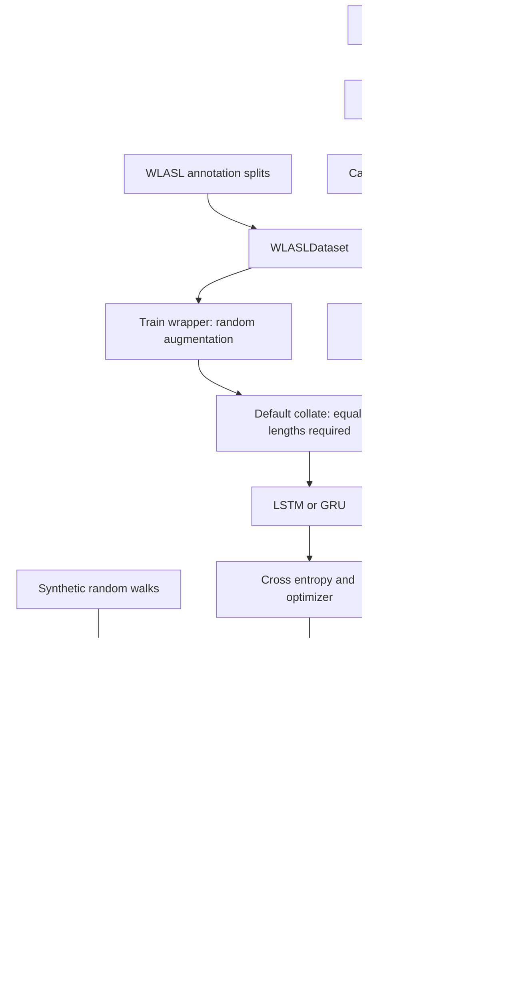

# 4. From a video to a defensible experiment

[Guide index](index.md) · Previous: [math and geometry](03-math-and-geometry.md) · Next: [project status](05-project-status.md)

An augmentation study needs two kinds of evidence: transformations must preserve useful motion, and a recognizer must improve on held-out data under a fair comparison. This chapter follows the **code present** at `45472c6a1f99e24ac5763eeae7acb3be01ff4886` (2026-05-08), audited 2026-10-01. It explains the available learning components and the gaps between them. It does not report a new training run or recognition result.

Excerpts labeled **verbatim** reproduce source with common leading indentation removed; explanations refer to original line numbers. Read sections 1–4 to trace a batch, then sections 5–7 to judge a benchmark.

## 1. Extract observations and assign labels

The recognizer consumes estimated landmarks, not RGB video. `WLASLPreprocessor.preprocess_video` opens `<video_id>.mp4`, reads frames with OpenCV, converts BGR to RGB, and calls legacy MediaPipe Holistic ([wlasl.py](../../src/kinetic_augment/evaluation/datasets/wlasl.py), lines 217–294). It allocates `(543,3)` zeros per frame and fills pose `0:33`, face `33:501`, left hand `501:522`, and right hand `522:543`. The **landmark estimator** is an upstream pretrained system; `SLRTrainer` does not train it. [Official Holistic description](https://github.com/google-ai-edge/mediapipe/blob/master/docs/solutions/holistic.md).

Missing blocks remain zero. No visibility/confidence values or missingness mask are saved. The loader later cannot reliably distinguish an undetected point from a genuine coordinate zero. Extraction uses `lm.x/y/z` from image landmark outputs, not `pose_world_landmarks`; normalized image coordinates and depth estimates should not be labeled meters. [MediaPipe coordinate definitions](https://developers.google.com/edge/mediapipe/solutions/vision/pose_landmarker).

A **gloss** is the annotation's word-level class label; recognizing such a label is narrower than interpreting a full signed sentence. `WLASLDataset` expects annotation JSON and cached `.npy` landmark clips. The original WLASL annotations also provide signer, source, frame boundaries, and frame-rate metadata. Those fields matter to correct clip preparation and split audits. [WLASL authors' data description](https://github.com/dxli94/WLASL).

### Walkthrough A: annotations become samples

**Verbatim excerpt:** [`WLASLDataset._load_annotations`](../../src/kinetic_augment/evaluation/datasets/wlasl.py), lines 111–136.

```python
for entry in annotations[:subset_num]:
    gloss = entry['gloss']
    gloss_idx = len(self.gloss_list)
    self.gloss_list.append(gloss)

    for instance in entry.get('instances', []):
        # Check split
        instance_split = instance.get('split', 'train')
        if instance_split != self.split:
            continue

        video_id = instance.get('video_id', '')
        if not video_id:
            continue

        # Check if landmark file exists
        landmark_path = self.landmark_dir / f"{video_id}.npy"
        if not landmark_path.exists():
            continue

        self.samples.append({
            'video_id': video_id,
            'gloss': gloss,
            'label': gloss_idx,
            'landmark_path': landmark_path,
        })
```

- Lines 111–114 select the first N entries, where N comes from `'wlasl100'` etc., and assign consecutive integer labels in annotation order. This assumes that order matches the desired subset. A class is added even when it has no usable clips.
- Lines 116–120 select instances by split. Missing split fields default to `'train'`; the loader does not create a new random split.
- Lines 122–129 require a video id and an existing landmark file. Missing ids/files are silently skipped, so intended and available sample counts can differ.
- Lines 131–136 store a minimal sample record: id, gloss, integer label, and landmark path. Signer id, source, and annotated clip boundaries are not retained in this record.

`__getitem__` loads the array, reshapes `(T,features)` to `(T,J,3)` when necessary, optionally truncates to `max_frames`, applies an optional transform, and returns float32 landmarks plus label (lines 151–170). It does not pad short clips or validate that J=543. `num_classes` counts gloss names, not classes with nonzero available training examples ([datasets/base.py](../../src/kinetic_augment/evaluation/datasets/base.py), lines 55–58).

The preprocessor reads each file to completion; it does not apply annotation frame boundaries or frame-rate resampling in `preprocess_video`. **Inference:** it assumes inputs have already been clipped appropriately. That assumption needs checking against the actual provenance of the videos. A cache file's existence alone proves neither correct clipping nor correct labels.

## 2. Dataset indexing and augmentation placement

A PyTorch **Dataset** answers “what is sample i?” with `__getitem__` and “how many indices are there?” with `__len__`. A **DataLoader** chooses indices, calls the Dataset, and collates multiple samples into a batch. It may parallelize loading with workers; it is not the neural network or optimizer. [PyTorch data API](https://docs.pytorch.org/docs/2.14/data.html).

`AugmentedLandmarkDataset` can virtually expand N clips to N×V indices. For N=3 and V=2, indices 0,1,2 and 3,4,5 refer to the same three base clips. They need not be six precomputed arrays on disk.

### Walkthrough B: virtual versions are generated on access

**Verbatim excerpt:** [`AugmentedLandmarkDataset.__getitem__`](../../src/kinetic_augment/pipeline/dataset.py), lines 159–181.

```python
# Map virtual index to base index
if self.mode == 'train' and self.num_augmented_versions > 1:
    version = idx // self._base_length
    base_idx = idx % self._base_length
else:
    version = 0
    base_idx = idx

# Check cache
cache_key = (base_idx, version) if self.mode == 'train' else base_idx
if self._cache is not None and cache_key in self._cache:
    data = self._cache[cache_key]
else:
    # Get base sample
    data = self._get_sample(base_idx)

    # Apply augmentation in train mode
    if self.mode == 'train' and self.pipeline is not None:
        data = self.pipeline.process(data)

    # Cache if enabled
    if self._cache is not None:
        self._cache[cache_key] = data
```

- Lines 160–162 divide a virtual index into version and base index. With N=3, index 4 is version 1 of base clip 1.
- Lines 163–165 use ordinary indexing when expansion is disabled or mode is not train. `__len__` also returns only N in validation mode (lines 139–144).
- Lines 168–170 look up the version-specific cache. A hit reuses the already computed augmentation.
- Lines 173–177 retrieve and augment the base sample only in train mode. All versions, including version 0, take this path; version 0 is not a guaranteed original copy.
- Lines 180–181 optionally cache that result. Default caching is false, so repeated accesses can draw new transformations.

Afterward line 185 converts to a float32 Torch tensor and lines 188–196 return the **base label unchanged**. Label reuse is a modeling assumption: the transformation should leave the annotated class intact. No sign-language validator runs here to establish it.

When wrapping a Dataset that returns `(data,label)`, `_get_sample` discards its label (lines 128–130); `_get_label` only uses the separately supplied `labels` collection (lines 133–137). Thus callers must supply labels explicitly to get a labeled result. The benchmark does so.

Dataset train/val mode and `model.train()/eval()` control different things. The former controls augmentation; the latter controls neural-network behavior such as dropout. Calling `model.eval()` does not switch the dataset out of train mode. Benchmark validation/test datasets have `pipeline=None, mode='val'`, which explicitly avoids their augmentation.

## 3. Batch variable-length sequences correctly

Default collation stacks equal-shaped samples. Two clips `(49,543,3)` and `(75,543,3)` cannot directly become one rectangular tensor. A common solution is **padding**: append zero frames to the shorter clip and record valid lengths. A **mask** identifies valid positions, conceptually `mask[b,t] = (t < length[b])`.

The repository supplies `LandmarkSequenceDataset`; it returns lengths rather than an explicit boolean time mask. Separate confidence/missing-landmark masks are not implemented. Valid length says which frames count; it does not say whether a hand was detected within a valid frame.

### Walkthrough C: augment, truncate, pad, return length

**Verbatim excerpt:** [`LandmarkSequenceDataset.__getitem__`](../../src/kinetic_augment/pipeline/dataset.py), lines 311–325. Augmentation happens immediately before this, on lines 307–309.

```python
# Truncate if needed
if seq.shape[0] > self.max_length:
    seq = seq[:self.max_length]

# Pad if needed
actual_length = seq.shape[0]
if actual_length < self.max_length:
    pad_shape = (self.max_length - actual_length,) + seq.shape[1:]
    padding = np.full(pad_shape, self.padding_value, dtype=seq.dtype)
    seq = np.concatenate([seq, padding], axis=0)

# Convert to tensor
if self.return_tensors:
    seq = torch.from_numpy(seq.astype(np.float32))
    actual_length = torch.tensor(actual_length)
```

- Lines 312–313 truncate after augmentation, so a temporal transformation that lengthens a clip can lose its tail.
- Line 316 records the remaining unpadded length. Lines 317–320 append enough frames to reach `max_length`, preserving the spatial dimensions and array dtype.
- Lines 323–325 convert both sequence and length to Torch tensors. The returned length is measured *after* augmentation/truncation; the constructor's stored `self.lengths` list is not what this method returns.

With max_length=75, a 49-frame sample returns data `(75,543,3)` and length 49. Two such padded samples collate into data `(2,75,543,3)`, lengths `(2,)`, and labels `(2,)`. `return_lengths=True` gives `(data,length,label)` when labels exist (lines 335–345), which matches trainer batch unpacking. For unlabeled input it gives `(data,length)`; that is not a labeled batch accepted by this trainer.

**Code present:** the benchmark instead wraps samples in `AugmentedLandmarkDataset` and uses default `DataLoader` collation ([runner.py](../../src/kinetic_augment/evaluation/benchmark/runner.py), lines 302–354). It supplies neither this padding dataset nor a custom `collate_fn`. **Verified now, in the bounded audit:** a miniature variable-length WLASL fixture fails at collation before an optimizer step. See [project status](05-project-status.md) for command/environment evidence. Merely adding `max_frames` would truncate long clips but still leave shorter ones unequal.

For the fixed-length route, `create_data_loaders` uses shuffle for training and no shuffle for validation ([dataset.py](../../src/kinetic_augment/pipeline/dataset.py), lines 363–408). It does not choose splits; datasets must already encode those. A future benchmark repair can wire the existing length-aware components, but that repair is **proposed work**, not part of this guide's changes.

## 4. Recognize a clip and update network weights

The baseline model flattens each frame into 1,629 features and processes time with an LSTM. An LSTM has a hidden state and a memory/cell state, controlled by learned gates. A bidirectional model reads both forward and backward through the clip. This is suitable for complete isolated clips; it needs future frames and is not an online recognizer. The class defaults are input_dim=1629, hidden_dim=256, num_layers=2, dropout=0.3, bidirectional=True ([lstm_classifier.py](../../src/kinetic_augment/evaluation/models/lstm_classifier.py), lines 48–94). [Official LSTM equations and state shapes](https://docs.pytorch.org/docs/2.14/generated/torch.nn.LSTM.html).

### Walkthrough D: packing and final hidden states

**Verbatim excerpt:** [`LSTMClassifier.forward`](../../src/kinetic_augment/evaluation/models/lstm_classifier.py), lines 112–139.

```python
# Flatten landmarks if needed
if x.dim() == 4:
    batch, seq_len, num_lm, coords = x.shape
    x = x.view(batch, seq_len, num_lm * coords)

# Pack sequences if lengths provided
if lengths is not None:
    # Sort by length for packing
    lengths_cpu = lengths.cpu()
    x_packed = nn.utils.rnn.pack_padded_sequence(
        x, lengths_cpu, batch_first=True, enforce_sorted=False
    )
    lstm_out, (h_n, c_n) = self.lstm(x_packed)
else:
    lstm_out, (h_n, c_n) = self.lstm(x)

# Get final hidden state
if self.bidirectional:
    # Concatenate forward and backward final hidden states
    # h_n shape: (num_layers * 2, batch, hidden_dim)
    forward_final = h_n[-2]  # Last layer, forward
    backward_final = h_n[-1]  # Last layer, backward
    final = torch.cat([forward_final, backward_final], dim=-1)
else:
    final = h_n[-1]

# Classify
logits = self.classifier(final)
```

- Lines 113–115 turn `(B,T,543,3)` into `(B,T,1629)`. This changes shape without changing the ordered values. `view` requires compatible tensor strides; ordinary collated contiguous tensors satisfy that use case.
- Lines 118–123 build a **PackedSequence** when lengths are provided. Packing lets the recurrent layer process valid steps without treating padded tail frames as observations; lengths go to CPU and callers need not sort the batch.
- Lines 124–126 run the LSTM with or without packing. Without lengths, zeros in padded frames are ordinary inputs and can change the final state.
- Lines 129–134 select the final layer's forward and backward hidden states and concatenate them. With two layers, B=2 and H=256, `h_n` is `(4,2,256)`, the two selected tensors are `(2,256)`, and the concatenation is `(2,512)`.
- Line 136 handles the unidirectional case. Line 139 feeds the chosen state through LayerNorm, dropout, and Linear to produce `(B,C)` logits.

The implementation uses final *hidden states*, not simply the last entry of `lstm_out`. In a bidirectional model those are different choices. No unpacking is needed because this classifier does not need one output per frame. Packing is not attention or a missing-joint mask. [PyTorch packed-sequence contract](https://docs.pytorch.org/docs/2.14/generated/torch.nn.utils.rnn.pack_padded_sequence.html).

`GRUClassifier` follows the same flatten/pack/concatenate/classify pattern (lines 187–210). A GRU uses gates and a hidden state but no separate LSTM-style cell state. It is an available alternative; the docstring's comparative speed/performance is a **historical claim**, not a measured repository result. [Official GRU equations](https://docs.pytorch.org/docs/2.14/generated/torch.nn.GRU.html).

A **logit** is an unnormalized class score. Cross entropy internally combines the normalization and negative log-likelihood, so training passes logits directly, without calling softmax first. For labels `(B,)`, each target is an integer class index in `[0,C−1]`. Conceptually the per-sample loss is `−log(exp(score_of_target)/sum(exp(all_scores)))`. [PyTorch CrossEntropyLoss](https://docs.pytorch.org/docs/2.14/generated/torch.nn.CrossEntropyLoss.html).

### Walkthrough E: one optimization step

**Verbatim excerpt:** [`SLRTrainer._train_epoch`](../../src/kinetic_augment/evaluation/models/trainer.py), lines 183–199. Lines 170–181 first unpack `(x,lengths,labels)` or `(x,labels)` and move tensors to the chosen device.

```python
    # Forward pass
    self.optimizer.zero_grad()
    logits = self.model(x, lengths)
    loss = self.criterion(logits, labels)

    # Backward pass
    loss.backward()
    torch.nn.utils.clip_grad_norm_(self.model.parameters(), max_norm=1.0)
    self.optimizer.step()

    # Metrics
    total_loss += loss.item() * x.size(0)
    preds = torch.argmax(logits, dim=-1)
    correct += (preds == labels).sum().item()
    total += x.size(0)

return total_loss / total, correct / total
```

- Line 184 clears gradients from the previous step; Torch accumulates gradients unless they are cleared.
- Lines 185–186 compute `(B,C)` logits and scalar batch loss. The train dataset has already applied NumPy augmentation during sample retrieval, before this differentiable graph exists.
- Line 189 backpropagates through the classifier to obtain network-weight gradients. This does not optimize landmarks, body-model pose, or augmentation settings.
- Line 190 clips the combined parameter-gradient norm to at most 1.0, reducing very large updates. Line 191 applies the optimizer's update.
- Line 194 weights the batch-mean loss by batch size for a sample-mean epoch loss. Lines 195–197 count top-1 predictions and samples. Line 199 divides totals to report mean loss and fractional accuracy.

Default optimizer is AdamW with learning rate 1e−3 and weight_decay=0.01 ([trainer.py](../../src/kinetic_augment/evaluation/models/trainer.py), lines 72–78). It adapts updates using running gradient statistics and decoupled weight decay; it is separate from the historical pose-fitting Adam loop discussed in chapter 3. [Official AdamW definition](https://docs.pytorch.org/docs/2.14/generated/torch.optim.AdamW.html).

Validation calls `model.eval()` and wraps computation in `torch.no_grad()` (lines 211–218), so dropout is disabled and no parameter updates happen. Reported metrics are mean cross entropy, top-1 fraction, and top-k fraction with k=min(5,C) (lines 230–250). With C≤5, top-5 includes every class and is automatically uninformative about ranking quality. Empty loaders reach division by zero; sample/split coverage should be checked before treating training as meaningful.

`train` keeps a CPU clone of `state_dict` when validation accuracy strictly improves, resets patience, and otherwise stops after patience epochs. It restores that best state before returning (lines 105–161). This is an **in-memory checkpoint**, not a saved `.pt` checkpoint or resume system. Since initial best accuracy is 0.0, no snapshot is stored if all validation accuracies stay at zero. A supplied scheduler is supported, but the benchmark supplies none. `ReduceLROnPlateau` receives validation loss; other schedulers step once per epoch (lines 123–128).

## 5. What the benchmark actually executes



Text fallback: prepared video → landmarks → annotation-filtered dataset → train augmentation or plain validation/test → collation → recognizer/loss → validation-selected weights → test metrics if successful. A separate synthetic random-walk branch supplies proxy quality metrics. The runner can return/report that branch without having trained a recognizer.

`ExperimentConfig` defaults are preset `'none'`, dataset `'wlasl100'`, model `'lstm'`, one virtual version, 50 epochs, batch_size=32, seed=42 ([runner.py](../../src/kinetic_augment/evaluation/benchmark/runner.py), lines 40–49). Runner defaults are CPU and zero workers. Exact `'gru'` selects GRU; any other model string falls through to LSTM (lines 357–361). `extra_params` is stored in the config but not consumed to configure model/trainer hyperparameters in this path.

Quality evaluation always generates **20 synthetic clips of 30 frames**, using Gaussian base coordinates plus cumulative random increments (lines 210–225). These are numerically motion-like random walks, not extracted WLASL signs or anatomically constructed skeletons. It augments them with `enforce_constraints=False` and computes four metrics on augmented outputs only (lines 239–248). It does not calculate a paired original-versus-augmented comparison there.

Training runs only if `run_training=True` and a dataset path exists. Missing imports or dataset-loading errors are caught inside `_run_training` and return `(None,None)` (lines 263–297). Other training failures bubble to `run`, which records an error and an empty quality-metric dictionary (lines 151–161). **Verified in the bounded audit:** missing annotations can leave `error=None` alongside populated quality metrics, `train_history=None`, and `test_metrics=None`. A result's presence or a successful report generation is therefore not evidence that recognition training ran.

After successful training the runner evaluates the unaugmented test loader and returns history/test metrics (lines 377–389). Its automatic `results.json` records selected config fields, quality metrics, test metrics, and error (lines 391–416); it omits training history, batch size, model weights, and full reproducibility metadata. `BenchmarkReport.save` is a separate call that defaults to txt/csv/md, with optional tex/json ([reports.py](../../src/kinetic_augment/evaluation/benchmark/reports.py), lines 242–276). Formatting values does not validate them.

## 6. Read metric definitions before their scores

A **proxy metric** measures one property related to a goal; it is not the goal itself. Smoothness can reward a frozen clip. Diversity can reward noise. Neither proves label preservation or generalization.

| Metric and source | Computation/units | Direction and limitation |
| --- | --- | --- |
| [LimbLengthConsistencyMetric](../../src/kinetic_augment/evaluation/metrics/quality.py), lines 118–159 | Relative variance `var(length)/mean(length)^2`; score `exp(−100*mean_relative_variance)`, dimensionless | Higher means more constant measured segment lengths. Constant wrong lengths can score well. Hand indices are incorrect for this layout. |
| [SmoothnessMetric](../../src/kinetic_augment/evaluation/metrics/temporal.py), lines 158–194 | Three differences divided by dt produce jerk in coordinate units/s³; score `exp(−normalized_jerk/100)` | Higher means less of the implemented jerk statistic. Default 30 fps may not match video fps. Formula's “dimensionless” comment is not established. |
| [VarianceMetric](../../src/kinetic_augment/evaluation/metrics/diversity.py), lines 45–77 | Flattens to `(T×J,3)`; overall variance has coordinate-units² | Larger means more numerical spread, with no universally better direction. Spatial spread dominates; this is not variance among augmented versions. PCA has at most three coordinate dimensions. |
| [JointLimitComplianceMetric](../../src/kinetic_augment/evaluation/metrics/constraint.py), lines 289–345 | Four elbow/knee triplets per frame; fraction of angles inside numerical ranges | Higher is nominal compliance, but angle convention/missingness problems prevent reading it as anatomical correctness. |
| [VelocityMetric](../../src/kinetic_augment/evaluation/metrics/temporal.py), lines 73–105; available, not a default runner metric | Raw position differences/dt have coordinate units/s; returned dimensionless score is `1/(1 + velocity_std/(mean_velocity+1e-6))` | Higher score means less relative velocity dispersion. Lower raw peaks mean slower motion, not necessarily better signing. m/s only follows from metric coordinates. |
| Trainer test accuracy/top-k | Correct clips / total clips, dimensionless fractions | Higher is better for the chosen held-out label task. Report formatter may display percent. It does not measure sentence translation or signer-level fairness. |

**Source-only finding:** limb consistency uses hand bases 468 and 489 ([quality.py](../../src/kinetic_augment/evaluation/metrics/quality.py), lines 178–201), but this repository's hands begin at 501 and 522. Its claimed hand segments include face points or cross-block points. Numerical output still exists; that does not mean it measured finger bones. This must be fixed or excluded before studying hand-length stability.

For compliance, the code forms vectors from the joint toward its two neighbors and uses arccos of their normalized dot product. A straight elbow gives opposite vectors, hence angle 180°, but the elbow cap is 145°. Flexion is usually described relative to straight extension, so comparing these values requires an explicit convention conversion. **Verified in the bounded audit:** straight test limbs score zero compliance; all-zero inputs score 1.0 because the zero vectors yield an apparent 90° angle. These are illustrative counterexamples, not biological validation. Consult [status](05-project-status.md).

**Source-only dimensional analysis:** `SmoothnessMetric` sums squared jerk and multiplies by duration⁵/path_length², then takes a square root (lines 171–177). Squared jerk has units distance²/time⁶; without a dt quadrature factor, the stated expression has units time⁻¹ before the square root. Its docstring's normalized/dimensionless description therefore exceeds the formula. It also sums path length across landmarks and uses duration=T*dt rather than the observed `(T−1)*dt` interval. Treat it as the exact repository statistic, not a calibrated published smoothness implementation.

`MetricAggregator` evaluates each clip separately and then takes the mean of clip-level scores, recording standard deviation/min/max/count ([evaluation/base.py](../../src/kinetic_augment/evaluation/base.py), lines 89–101, 150–166). This gives each clip equal weight regardless of its length. Those standard deviations describe input clips, not repeated-training uncertainty. Errors can appear as NaN values/details; inspect them before comparing tables.

## 7. Design a fair study after the integration gaps are addressed

The following is **proposed work**, not a claim about completed experiments or a researcher's unstated intent.

1. Freeze an annotation version and build an availability manifest with video id, gloss, signer/source, frame count, fps, missing-detection rate, and split. Count dropped files and zero-example classes. Keep every derived version of a clip in its original split; audit signer/source overlap for the generalization question being asked. An official split label alone is not a local verification of signer disjointness.
2. Correct/verify representation and metric contracts, then wire padding and lengths for all three loaders. Confirm that intended transformations execute and preserve useful signed content on a small reviewed set. The current bone-vector route and landmark constraint bypass cannot supply an anatomical guarantee.
3. Compare an unaugmented baseline with one transformation at a time, then a selected combination. Hold model, preprocessing, splits, optimizer and evaluation fixed. Record the number of optimizer steps: V virtual versions increase batches per epoch, so equal epochs at different V are unequal training budgets. Add an equal-step baseline to separate augmentation effects from extra optimization.
4. Use validation for selecting magnitudes, stopping epoch, and model. Evaluate the test set after choices are fixed. Report top-1, appropriate top-k, per-class recall/confusion, sample coverage, and uncertainty across repeated seeds. A gain on one random initialization is weak evidence of a general effect.
5. Record code SHA, effective config, dependencies, hardware, initialization and augmentation seeds, worker behavior, and selected state. Pair baseline/augmentation runs by seeds where practical, while reporting variability. Save model/checkpoint metadata as an explicit future addition rather than assuming the runner's JSON already contains it.

The provided `experiments.py` offers preset comparisons, five individual landmark operations, virtual factors `[1,2,5,10]`, and constraint-labeled configs. These are experiment templates. The constraint ablations all use landmark mode, whose current pipeline enforcement is bypassed; synthetic quality evaluation also explicitly disables constraints. Thus the present “joint limits” or “all constraints” labels do not isolate enforced anatomical constraints ([experiments.py](../../src/kinetic_augment/evaluation/benchmark/experiments.py), lines 124–183). `get_standard_experiments` combines preset/individual/constraint lists but does not include the factor sweep or `QUICK_TEST` automatically (lines 205–227).

Reproducibility requires more than `seed=42`. Pipeline reset seeds the chain's step-selection generator, while transformation internals use global NumPy RNG. Runner code does not seed Torch model initialization/training, Python randomness, or DataLoader workers. **Verified in the bounded audit:** resetting a probability-one scaling pipeline seed alone did not replay the same output. The official [PyTorch reproducibility guidance](https://docs.pytorch.org/docs/2.14/notes/randomness.html) explains the separate RNG and worker controls; it also cautions that identical results are not guaranteed across releases/platforms. Here those controls are future experiment setup work, not current runner behavior.

The five cached local clips are useful for checking shapes and visually examining transformations. The audit found no WLASL annotation JSON or held-out recognition artifacts in the checked data trees. Phase tests and synthetic metrics provide limited component evidence; mock report accuracies are formatting fixtures. No baseline-versus-augmentation improvement on real WLASL is established by those files. [Project status](05-project-status.md) gives the precise verification scope, and [learning roadmap](06-learning-roadmap.md) helps turn these gaps into a bounded research question.
